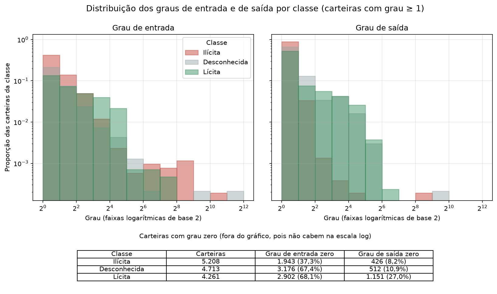
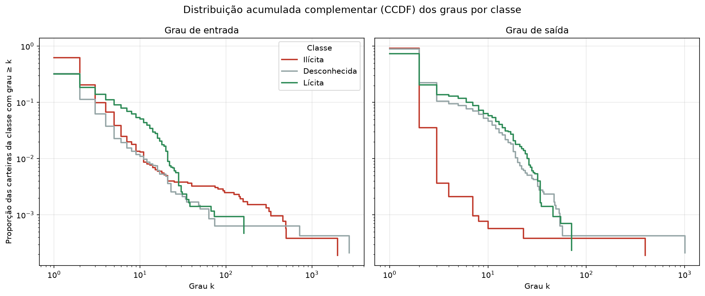
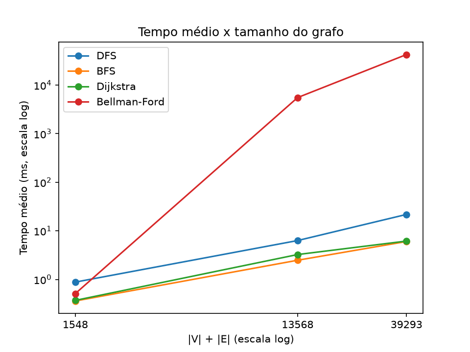
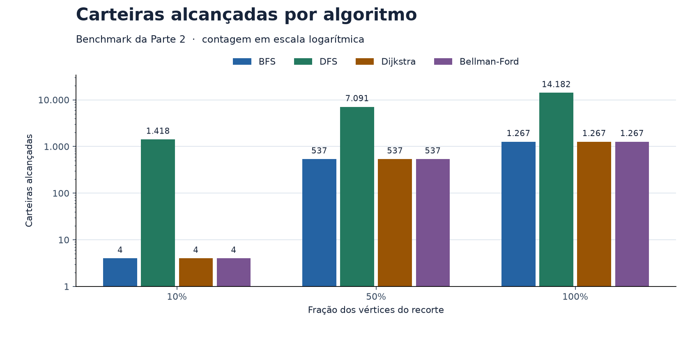
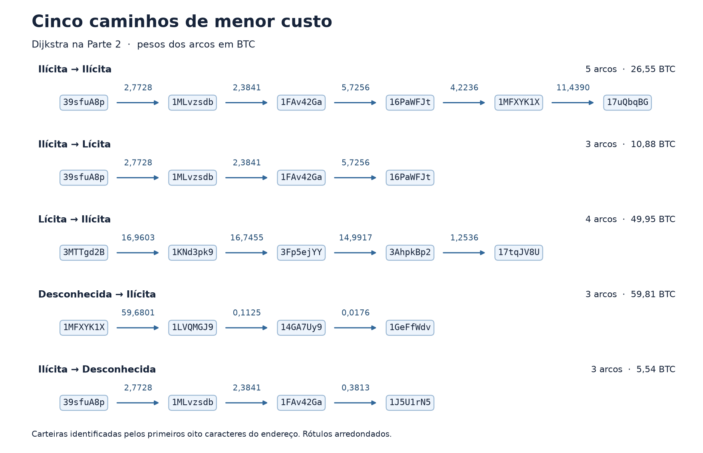
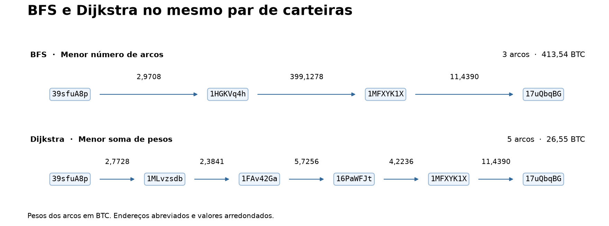

<!-- [IA] Claude Code – esqueleto do relatório: seções tiradas do enunciado, partes factuais preenchidas a partir do repositório; análises, discussões, prova e conclusões ficam para o grupo -->

# Projeto Final — Teoria dos Grafos + AVD (2026.2)

**Labirinto com Chaves (Grafo de Estados) + Comparação de Algoritmos no Elliptic++**

Matheus Araujo · Thomaz Lima · Davi Marques Oliveira · Vagner Montenegro de Melo

Repositório: <https://github.com/davimqz/Projetos-Grafos> · Entrega: 26/11/2026

> **Como usar este esqueleto.** Cada bloco marcado com **[A ESCREVER]** diz o que o enunciado pede e quem é o dono.
> Pelas regras de IA, análises, discussões, conclusões, notas analíticas e a prova do m05 têm que ser escritas por
> nós; a IA só pode revisar ortografia e clareza depois. Apagar este aviso e os marcadores antes de gerar o PDF.

---

## Sumário

1. Introdução
2. Manual de uso
3. Implementação comum (grafo e algoritmos)
4. Parte 1 — Labirinto com Chaves
5. Parte 2 — Elliptic++
6. AVD — análise exploratória e explanatória
7. Testes
8. Limitações
9. Conclusões
10. Matriz de contribuição
11. Uso de IA

---

## 1. Introdução

Este projeto tem como objetivo implementar, do zero e sem o uso de bibliotecas especializadas em algoritmos de grafos,
as estratégias de busca em largura (BFS), busca em profundidade (DFS), Dijkstra e Bellman-Ford, aplicando-as a dois
problemas distintos. A primeira parte aborda a resolução de labirintos com mecânicas adicionais, como chaves, portas,
esteiras, bônus e fontes de energia. Nesse contexto, cada posição do mapa pode representar diferentes estados,
dependendo das chaves coletadas e dos bônus já consumidos durante o percurso. Foram utilizados oito mapas
disponibilizados pelo enunciado, incluindo o maior deles, de dimensões 31 × 71, além de dois mapas desenvolvidos pelo
grupo. A segunda parte utiliza o conjunto de dados Elliptic++, que representa uma rede de transações Bitcoin composta
originalmente por 822.942 carteiras e aproximadamente 2,87 milhões de arcos, da qual foi extraído um recorte com
14.182 carteiras e 25.111 arcos para análise.

A partir desse segundo problema, busca-se investigar a seguinte questão: **carteiras ilícitas participam mais de
ciclos de repasse (ciclos negativos) do que as lícitas?** Para isso, aplicam-se os algoritmos implementados ao recorte,
usando o saldo da carteira de destino como peso dos arcos, o que permite valores negativos, e a análise exploratória e
explanatória dos dados complementa a investigação. O relatório está organizado em seções que apresentam o manual de
utilização, os detalhes da implementação, os resultados da aplicação dos algoritmos nas duas partes do projeto, a
análise e visualização dos dados (AVD), os testes realizados, as limitações identificadas, as conclusões obtidas, a
matriz de contribuição dos integrantes do grupo e, por fim, o uso de IA.

---

## 2. Manual de uso

### 2.1 Instalação

Python 3.11 ou mais novo.

```bash
git clone https://github.com/davimqz/Projetos-Grafos.git
cd Projetos-Grafos
python -m venv .venv
# Windows: .venv\Scripts\activate   |   Linux/macOS: source .venv/bin/activate
pip install -r requirements.txt
pytest
```

O recorte da Parte 2 já está em `data/dataset_parte2/`; não é preciso baixar o dataset.

### 2.2 Parte 1

```bash
python -m src.cli --mapa ./data/mapas/m03_tres_chaves.txt --alg BFS --out ./out/parte1/
python -m src.cli --mapa ./data/mapas/m03_tres_chaves.txt --alg DIJKSTRA --out ./out/parte1/
python -m src.cli --mapa ./data/mapas/m05_bonus.txt --alg BELLMAN_FORD --out ./out/parte1/
python -m src.cli --mapa ./data/mapas/m06_fonte.txt --alg BELLMAN_FORD --fonte-consumivel --out ./out/parte1/
python -m src.cli --mapa ./data/mapas/m04_esteiras.txt --armadilhas --out ./out/parte1/
python -m src.cli --mapa ./data/mapas/m03_tres_chaves.txt --interactive --out ./out/parte1/
python -m src.visualizar_parte1 --out ./out/parte1/
```

> **[COMPLETAR — Matheus]** Comando que gera as saídas do P3 (`solve.py`) quando entrar na main.

### 2.3 Parte 2

```bash
python -m src.cli --dataset ./data/dataset_parte2/ --alg BFS --source <carteira> --out ./out/parte2/
python -m src.cli --dataset ./data/dataset_parte2/ --alg DFS --source <carteira> --out ./out/parte2/
python -m src.cli --dataset ./data/dataset_parte2/ --alg DIJKSTRA --source <carteira> --target <carteira> --out ./out/parte2/
python -m src.cli --dataset ./data/dataset_parte2/ --alg BELLMAN_FORD --source <carteira> --out ./out/parte2/
python -m src.cli --dataset ./data/dataset_parte2/ --benchmark --out ./out/parte2/
```

### 2.4 Labirinto interativo

> **[A ESCREVER — Thomaz]** Como abrir o `out/parte1/labirinto_interativo.html` e o que cada controle faz (seleção de
> mapa e algoritmo, passo a passo, velocidade, camadas, armadilhas). Incluir 1 captura de tela.

### 2.5 Front-end em React (extra)

```bash
python -m scripts.exportar_front
cd front-react && npm install && npm run dev
```

> **[A ESCREVER — Vagner]** Uma frase sobre o que o front mostra e 1 captura de tela.

---

## 3. Implementação comum (grafo e algoritmos)

Os algoritmos estão em `src/graphs/algorithms.py`, sobre a lista de adjacência dirigida de `src/graphs/graph.py`
(vizinhos na ordem N, L, S, O). As mesmas funções são usadas nas duas partes. O `networkx` aparece só em `tests/`,
como oráculo.

| Algoritmo | Entrada | Saída | Complexidade |
|---|---|---|---|
| BFS | grafo, origem | ordem, nível de cada nó, árvore | O(V + E) |
| DFS | grafo, origem | ordem, arcos de árvore/retorno/avanço/cruzamento, existência de ciclo | O(V + E) |
| Dijkstra (`heapq`) | grafo com pesos ≥ 0, origem | distâncias e caminho; recusa peso negativo | O((V + E) log V) |
| Bellman-Ford | grafo, origem | distâncias e caminho, ou o ciclo negativo reconstruído | O(V · E) |

> **[A ESCREVER — Thomaz]** Decisões de implementação que valem explicar: como a DFS classifica cada arco (tempos de
> descoberta/término), como o Dijkstra recusa peso negativo, como o Bellman-Ford reconstrói o ciclo.

---

## 4. Parte 1 — Labirinto com Chaves

### 4.1 Modelagem: G_pos e G_est

> **[A ESCREVER — Matheus]** O que é um nó em cada grafo, o rótulo `(l,c)|chaves|{bônus}`, a numeração dos bônus em
> ordem de leitura, a construção por exploração a partir de `S`, o nó `ALVO` com arco de custo 0 e as variantes
> (portas como chão/parede, `+` fixo, fonte consumível). Incluir o G_est do m02 desenhado à mão.

### 4.2 Por que o grafo tem que ser dirigido

> **[A ESCREVER — Matheus]** Exigido pelo enunciado (Seção 2). Pensar em esteiras e em pegar uma chave.

### 4.3 Mapa mínimo contado à mão

> **[A ESCREVER — Matheus]** O mapa de até 5×7 usado em `tests/test_estados.py`, com o número de estados e de arcos
> contado à mão e a indicação do teste que confere.

### 4.4 Métricas globais e por camada

Fonte: `out/parte1/metricas_global.json` e `out/parte1/camadas.json`.

| Mapa | G_pos: ordem | tamanho | densidade | G_est: ordem | tamanho | densidade | teto teórico | ocupação |
|---|---|---|---|---|---|---|---|---|
| m01 … m08 | | | | | | | | |

> **[A ESCREVER — Matheus]** Comentário da tabela, métricas por camada, quantos arcos ligam camadas e **por que são
> exatamente aquelas casas**.

### 4.5 Graus, multiplicidade e becos

Fonte: `out/parte1/graus_<mapa>.csv`, `out/parte1/heatmap_m08.png`.

> **[A ESCREVER — Matheus]** Maior grau de entrada e de saída por mapa; multiplicidade máxima no m08, quantas casas a
> atingem e por quê; becos encontrados.

### 4.6 Comparação de modelagens (m02, m03, m04)

Fonte: `out/parte1/comparacao_modelagem.csv`.

| Mapa | Abordagem | Passos | Caminho válido | Observação |
|---|---|---|---|---|
| | portas como chão | | | |
| | portas como parede | | | |
| | G_est | | | |

> **[A ESCREVER — Matheus]** Por que (a) gera caminho inválido e (b) falha.

### 4.7 m05: pesos negativos e a prova

Fonte: Bellman-Ford no G_pos com `+` fixo em −4 × no G_est.

> **[A ESCREVER — Matheus]** Resultado dos dois casos e a **prova** de que o G_est do m05 não tem ciclo negativo
> (dica do enunciado: o que acontece com o conjunto de bônus ao longo de um caminho?).

### 4.8 Caminhos nos mapas

Fonte: `out/parte1/solucoes.csv`, `out/parte1/dfs_classificacao.csv`, `out/parte1/percurso_m03.json`.

| Mapa | BFS (passos) | Dijkstra (custo / status) | Bellman-Ford | DFS: árvore / retorno / avanço / cruzamento |
|---|---|---|---|---|
| m01 … m08, mapas do grupo | | | | |

> **[A ESCREVER — Matheus e Thomaz]** Discussões obrigatórias:
> - **m01:** por que BFS e Dijkstra dão caminhos diferentes;
> - **m06:** o ciclo negativo (sequência de estados e custo, de `ciclo_negativo_m06.json`), a correção com
>   `--fonte-consumivel` e o resultado finito do Bellman-Ford;
> - **m07:** como a busca mostra que não há solução e quantos estados são alcançáveis.

### 4.9 Estados-armadilha (m04 e m07)

Fonte: `out/parte1/armadilhas_m04.csv`, `out/parte1/armadilhas_m07.csv`.

> **[A ESCREVER — Matheus]** Método (busca a partir de `ALVO` no grafo transposto), quantos estados são armadilha e
> exemplos.

### 4.10 Mapas do grupo

Fonte: `data/mapas_grupo/`.

| Mapa | Estados | Arcos | Passos (BFS) | Custo (Dijkstra ou BF) | % armadilhas |
|---|---|---|---|---|---|
| mapa 1 (≥ 3 chaves, esteira e bônus no caminho ótimo) | | | | | |
| mapa 2 (≥ 20% de armadilhas) | | | | | |

> **[A ESCREVER — Matheus]** Desenho de cada mapa e o que ele exercita.

### 4.11 Visualizações

Figuras em `out/parte1/`:

- `percurso_m03.png` e `percurso_m08.png`: percurso de menor custo, com a cor mudando a cada chave;
- `camadas_m02.png`: G_est do m02 por camada, destacando os arcos entre camadas;
- `arvore_bfs_m02.png`: árvore BFS do m02 com os níveis;
- `heatmap_m08.png`: multiplicidade das casas do m08.

> **[A ESCREVER — Thomaz]** Inserir as figuras com legenda e uma frase sobre o que cada uma mostra.

---

## 5. Parte 2 — Elliptic++

> O conteúdo detalhado já está em [`parte2.md`](parte2.md) e em [`../PARTE2_DATASET.md`](../PARTE2_DATASET.md).
> Aqui entra a versão final, resumida, para o PDF.

### 5.1 Dataset e recorte

Fonte: Elliptic++ (<https://github.com/git-disl/EllipticPlusPlus>), grafo de carteiras (endereço → endereço).

| | Grafo completo | Recorte usado |
|---|---|---|
| Carteiras (nós) | 822.942 | 14.182 |
| Arcos | 2.868.964 | 25.111 |
| Tipo | dirigido | dirigido, ponderado |

Recorte em bola de neve a partir de 50 carteiras ilícitas sorteadas (seed 42), expandindo por vizinhos de entrada e
saída até pelo menos 25.000 arestas no subgrafo induzido. Laços removidos (45.981) e arestas repetidas agregadas em um
arco por par.

Na preparação dos dados, removemos os laços (A → A), pois representam troco e poderiam gerar ciclos negativos artificiais. Também agregamos arestas repetidas entre as mesmas carteiras, somando os valores das transações para o Dijkstra, e mantivemos uma única linha por carteira, já que o dataset repete em cada intervalo de tempo (time step) os totais da vida inteira da carteira; somar essas linhas contaria o mesmo valor várias vezes. Para reduzir o tamanho do grafo, aplicamos um recorte em bola de neve, partindo das carteiras ilícitas e expandindo para seus vizinhos. Essa estratégia preserva as conexões, ao contrário da amostragem aleatória. O recorte foi necessário porque o grafo completo possui 2,87 milhões de arestas, acima do limite de aproximadamente 500 mil arestas a partir do qual o enunciado exige amostragem.

#### Caracterização estrutural e distribuição dos graus

O grafo analisado é direcionado e composto por 14.182 vértices (carteiras) e 25.111 arcos (pares de carteiras que transacionaram entre si). A análise da distribuição dos graus de entrada e saída revela uma concentração de conexões em valores baixos, acompanhada pela presença de algumas carteiras com número expressivamente elevado de conexões. Considerando o conjunto completo, ambos os tipos de grau apresentam média de 1,77. Entretanto, as medianas diferem: o grau de entrada possui mediana igual a zero, enquanto o grau de saída apresenta mediana igual a um. Essa diferença também é observada na quantidade de carteiras sem conexões: 8.021 (56,6%) têm grau de entrada zero, enquanto 2.089 (14,7%) têm grau de saída zero.

A distribuição também apresenta diferenças entre as classes. No grau de entrada, as carteiras ilícitas possuem mediana igual a um, enquanto as lícitas e desconhecidas apresentam mediana igual a zero. Além disso, 37,3% das carteiras ilícitas não possuem conexões de entrada, proporção consideravelmente inferior à observada nas classes desconhecida (67,4%) e lícita (68,1%). No grau de saída, as três classes apresentam mediana igual a um, mas a proporção de carteiras sem conexões de saída varia: 8,2% entre as ilícitas, 10,9% entre as desconhecidas e 27,0% entre as lícitas.

Outro aspecto relevante é a presença de carteiras com graus muito superiores aos valores predominantes na rede. No grau de entrada, o maior valor identificado pertence a uma carteira desconhecida, com 2.719 conexões, seguida por uma carteira ilícita, com 1.996. Entre as lícitas, o maior grau de entrada é 162. Para o grau de saída, os maiores valores também pertencem às classes desconhecida e ilícita, com 1.002 e 398 conexões, respectivamente, enquanto a carteira lícita de maior grau de saída apresenta 71 conexões. Esses valores evidenciam a existência de vértices com elevada concentração de conexões, que se destacam em relação à distribuição predominante.

As Figuras 5.1 e 5.2 apresentam, respectivamente, a distribuição dos graus por meio de histogramas e da distribuição acumulada complementar (CCDF), considerando as três classes de carteiras. A utilização de escalas logarítmicas permite visualizar diferentes ordens de magnitude, enquanto a CCDF complementa os histogramas ao demonstrar a proporção de carteiras que alcança ou supera determinado valor de grau. Em conjunto, as representações permitem observar tanto a concentração de conexões em graus menores quanto o comportamento das distribuições nas faixas de graus mais elevados.



*Figura 5.1 — Distribuição dos graus de entrada e de saída por classe, em escala log-log com faixas de base 2. O eixo vertical é a proporção das carteiras da classe; as carteiras com grau zero estão na tabela abaixo dos gráficos.*



*Figura 5.2 — Distribuição acumulada complementar (CCDF) dos graus por classe: proporção das carteiras da classe com grau maior ou igual a k, em escala log-log.*

Por fim, a caracterização evidencia diferenças estruturais entre as classes, especialmente na quantidade de carteiras sem conexões e na presença de vértices com graus elevados. Essas características são relevantes para contextualizar as análises posteriores de caminhos e ciclos na rede, sem implicar, por si só, qualquer relação direta entre o número de conexões e a participação em ciclos negativos.

Os números vêm de `out/parte2/graus_resumo.json` e `out/parte2/graus_zero.csv`, gerados por `python -m scripts.graus_parte2`.

### 5.2 Pesos, caminho mínimo e ciclo negativo

| Peso | Algoritmo | Definição |
|---|---|---|
| `valor_btc` | Dijkstra | soma do `total_BTC` das transações do par A → B (≥ 0) |
| saldo do destino | Bellman-Ford | `btc_received_total − btc_sent_total` da carteira B |

No Bellman-Ford, utilizamos como peso o saldo da carteira de destino (B), calculado pela diferença entre o total de BTC recebidos e enviados. Como o dataset não possui pesos nas arestas e os valores das transações são sempre não negativos, o saldo é a única grandeza que permite obter valores negativos sem inventá-los. Um saldo positivo indica acúmulo de BTC, enquanto um negativo indica que a carteira envia mais do que recebe. Não usamos a diferença entre os saldos de A e B porque, nesse caso, a soma dos pesos em qualquer ciclo seria sempre zero, impossibilitando a identificação de ciclos negativos. Assim, esses ciclos podem indicar padrões de circulação de fundos entre carteiras, que são o foco da pesquisa. Utilizamos o grafo de carteiras porque o grafo de transações não possui ciclos, já que cada transação depende de saídas anteriores.

No Dijkstra, utilizamos como peso a soma dos valores das transações entre A e B (valor_btc), pois ela já existe no dataset e é não negativa. Dessa forma, o caminho mínimo representa a rota com a menor soma dos valores movimentados.

**Pergunta de pesquisa:** carteiras ilícitas participam mais de ciclos de repasse (ciclos negativos) do que as lícitas?

### 5.3 BFS e DFS (3 fontes)

Fonte: `out/parte2/bfs_*.json`, `out/parte2/dfs_*.json`.

#### Escolha das carteiras analisadas

Foram selecionadas três carteiras para a análise: uma ilícita, uma lícita e uma desconhecida.

A seleção foi feita a partir das **5 carteiras com maior número de arcos de saída de cada classe**. O objetivo foi comparar a estrutura das redes alcançáveis a partir dessas fontes.

##### Carteira ilícita

- **Endereço:** `39sfuA8pY4UfybgEZi7uvA13jkGzZpsg5K`
- **Arcos de saída:** 398.
- **Critério de seleção:** maior número de arcos de saída entre as 5 carteiras ilícitas listadas.
- **BFS:** alcançou 1.737 carteiras, incluindo a origem, distribuídas em 8 camadas.
- **DFS:** identificou arcos de retorno, indicando ciclos na região alcançável.

##### Carteira lícita

- **Endereço:** `35fNF5Uwbsoa5ABPCUvKZNyuAV7S9sJTou`
- **Arcos de saída:** 71.
- **Critério de seleção:** maior número de arcos de saída entre as 5 carteiras lícitas listadas.
- **BFS:** alcançou 81 carteiras, incluindo a origem, distribuídas em 3 camadas.
- **DFS:** não identificou arcos de retorno na região alcançável.

##### Carteira desconhecida

- **Endereço:** `1MFXYK1XucKFfhPhW9HDHD3vsM9BKey4qm`
- **Arcos de saída:** 1.002.
- **Critério de seleção:** maior número de arcos de saída entre as 5 carteiras desconhecidas listadas.
- **BFS:** alcançou 1.267 carteiras, incluindo a origem, distribuídas em 7 camadas.
- **DFS:** identificou arcos de retorno, indicando ciclos na região alcançável.

A carteira permanece classificada como desconhecida, pois os resultados estruturais não permitem determinar sua classificação.

#### BFS — Busca em Largura

A BFS (Busca em Largura) permite analisar quantas carteiras podem ser alcançadas a partir de uma carteira inicial e a distância de cada uma em relação à origem.

A exploração ocorre por camadas: primeiro são analisadas as conexões mais próximas, depois as conexões seguintes e assim por diante.

Neste trabalho, **a contagem inclui a própria carteira de origem, identificada como camada 0**. Portanto, o total de carteiras alcançadas também inclui a origem.

##### Resultados gerais

| Classe | Carteiras alcançadas, incluindo a origem | Camadas, incluindo a origem | Distância máxima |
|---|---:|---:|---:|
| Ilícita | 1.737 | 8 | 7 |
| Lícita | 81 | 3 | 2 |
| Desconhecida | 1.267 | 7 | 6 |

A carteira ilícita apresentou o maior alcance entre as três fontes analisadas, com 1.737 carteiras.

A carteira desconhecida alcançou 1.267 carteiras, enquanto a carteira lícita apresentou um alcance menor, com 81 carteiras.

Esses resultados mostram diferenças na extensão das regiões alcançáveis a partir das fontes selecionadas.

##### Distribuição das carteiras por camada

A tabela abaixo mostra como as carteiras alcançadas estão distribuídas em cada camada da BFS. Cada linha representa a quantidade de carteiras encontradas a uma determinada distância da origem.

| Camada | Ilícita | Lícita | Desconhecida |
|---|---:|---:|---:|
| 0 — Origem | 1 | 1 | 1 |
| 1 | 398 | 71 | 1.002 |
| 2 | 90 | 9 | 141 |
| 3 | 988 | — | 19 |
| 4 | 149 | — | 17 |
| 5 | 17 | — | 56 |
| 6 | 63 | — | 31 |
| 7 | 31 | — | — |
| **Total** | **1.737** | **81** | **1.267** |

##### Interpretação da distribuição

A carteira ilícita apresenta uma expansão expressiva na terceira camada, com 988 carteiras encontradas nessa distância. Isso indica que uma parcela significativa do seu alcance está concentrada a três conexões da origem.

A carteira lícita apresenta uma rede mais curta: são 71 carteiras na primeira camada e 9 na segunda. Como a origem também é contabilizada, o total alcançado é de 81 carteiras em 3 camadas.

A carteira desconhecida apresenta uma concentração muito elevada na primeira camada, com 1.002 carteiras diretamente alcançáveis a partir da origem. Nas camadas seguintes, a quantidade de carteiras diminui significativamente em relação à primeira camada, embora apresente algumas oscilações ao longo da expansão, como o aumento de 17 para 56 carteiras na camada 5.

Essas diferenças mostram que não basta observar o alcance total: a distribuição por camada também ajuda a compreender como cada rede se expande.

#### DFS — Busca em Profundidade

A DFS (Busca em Profundidade) explora um caminho do grafo até onde for possível antes de retornar e investigar outras conexões.

Durante a execução, os arcos são classificados em quatro categorias:

| Classe | Árvore | Retorno | Avanço | Cruzamento |
|---|---:|---:|---:|---:|
| Ilícita | 1.736 | 103 | 194 | 549 |
| Lícita | 80 | 0 | 0 | 30 |
| Desconhecida | 1.266 | 98 | 253 | 450 |

##### Significado dos arcos

- **Árvore:** arcos utilizados para descobrir novos vértices durante a DFS.
- **Retorno:** arcos que conectam um vértice a um de seus ancestrais na árvore DFS. Em grafos direcionados, indicam a presença de ciclos.
- **Avanço:** arcos que conectam um ancestral a um descendente já descoberto, sem terem sido utilizados para descobrir esse descendente.
- **Cruzamento:** arcos entre vértices que não possuem relação direta de ancestralidade na árvore DFS.

##### Interpretação

A carteira ilícita apresentou 103 arcos de retorno, enquanto a desconhecida apresentou 98.

Isso indica que **as regiões alcançáveis a partir dessas carteiras possuem ciclos**.

Já a carteira lícita não apresentou arcos de retorno, indicando que não foram identificados ciclos em sua região alcançável durante a execução da DFS.

É importante destacar que encontrar ciclos na região alcançável não significa que a carteira de origem participa diretamente deles. Essa distinção será importante para responder à pergunta de pesquisa.

### 5.4 Dijkstra (5 pares)

Fonte: `out/parte2/dijkstra_*.json`.

<!-- [IA] Claude Code – estrutura da seção, tabelas montadas a partir dos JSONs de out/parte2/ e transcrição literal das justificativas escritas pelo Davi. As interpretações foram escritas pelo Davi. -->

#### Critérios de escolha

##### Bellman-Ford

- **Caso com ciclo negativo:** carteira desconhecida `1MFXYK1XucKFfhPhW9HDHD3vsM9BKey4qm`, a mesma usada no BFS e na DFS.
- **Caso sem ciclo negativo:** escolher a carteira lícita `3Fzzji5nFaSptmYL8bNsm3KcpYm3qnxqBS`, pois, entre as carteiras que atendem ao requisito de pesos negativos sem ciclo negativo, é a que alcança a maior quantidade de arcos negativos (29).

##### Dijkstra

Peso: `valor_btc`, a soma dos valores das transações entre as duas carteiras (ver "Design dos pesos").

Quero analisar cinco combinações: Ilícita → Ilícita; Ilícita → Lícita; Lícita → Ilícita; Desconhecida → Ilícita; Ilícita → Desconhecida. O objetivo é comparar a circulação entre as classes e investigar principalmente as relações entre carteiras lícitas e ilícitas, considerando os dois sentidos das conexões.

As origens são as mesmas carteiras usadas no BFS e na DFS.

**Critério do destino:** selecionar o primeiro destino da classe desejada na ordem de visita do BFS, desde que esteja a pelo menos 3 passos da origem. Assim, conseguimos analisar trajetórias com carteiras intermediárias, em vez de considerar apenas transferências diretas.

**Origem do par Lícita → Ilícita:** a carteira lícita usada no BFS só alcança carteiras ilícitas a até 2 passos. Utilizar outra carteira lícita como origem mantém o critério de pelo menos 3 passos uniforme entre as combinações do Dijkstra, evitando uma exceção metodológica. Para selecionar a origem: escolher a carteira lícita que alcança o maior número de carteiras ilícitas a partir de 3 passos de distância. Em caso de empate, utilizar a que apresentar a maior distância mínima média até os destinos ilícitos selecionados.

Como as cinco carteiras empataram nos dois primeiros critérios (quantidade de destinos ilícitos alcançados e distância média), utilizamos o número de transações como terceiro critério de desempate. Isso privilegia a carteira com maior atividade transacional e oferece uma origem mais representativa para a análise de caminhos.

#### Resultados do Dijkstra

| Par | Origem | Destino | Custo (BTC) | Arcos | Caminho |
|---|---|---|---|---|---|
| Ilícita → Ilícita | `39sfuA8p…` | `17uQbqBG…` | 26,55 | 5 | `39sfuA8p` → `1MLvzsdb` → `1FAv42Ga` → `16PaWFJt` → `1MFXYK1X` → `17uQbqBG` |
| Ilícita → Lícita | `39sfuA8p…` | `16PaWFJt…` | 10,88 | 3 | `39sfuA8p` → `1MLvzsdb` → `1FAv42Ga` → `16PaWFJt` |
| Lícita → Ilícita | `3MTTgd2B…` | `17tqJV8U…` | 49,95 | 4 | `3MTTgd2B` → `1KNd3pk9` → `3Fp5ejYY` → `3AhpkBp2` → `17tqJV8U` |
| Desconhecida → Ilícita | `1MFXYK1X…` | `1GeFfWdv…` | 59,81 | 3 | `1MFXYK1X` → `1LVQMGJ9` → `14GA7Uy9` → `1GeFfWdv` |
| Ilícita → Desconhecida | `39sfuA8p…` | `1J5U1rN5…` | 5,54 | 3 | `39sfuA8p` → `1MLvzsdb` → `1FAv42Ga` → `1J5U1rN5` |

Endereços completos e peso de cada arco: `out/parte2/dijkstra_<origem>_<destino>.json`.

##### Interpretação dos resultados do Dijkstra

A aplicação do algoritmo de Dijkstra permitiu identificar os caminhos de menor custo entre cinco pares de carteiras de diferentes classificações, utilizando `valor_btc` como peso das arestas. Os custos encontrados variaram entre 5,54 BTC e 59,81 BTC, evidenciando diferenças nas trajetórias de circulação de recursos entre as classes analisadas.

Na comparação entre os pares Lícita → Ilícita e Ilícita → Lícita, foram observados custos de 49,95 BTC e 10,88 BTC, respectivamente. É importante destacar que se trata de pares distintos de carteiras, com origens e destinos diferentes, e não da inversão de um mesmo trajeto. Portanto, a diferença evidencia características específicas dos caminhos selecionados, mas não permite estabelecer uma assimetria geral na circulação entre essas classes.

Outro aspecto observado foi a repetição da sequência de carteiras `39sfuA8p → 1MLvzsdb → 1FAv42Ga` em três caminhos que partem de uma origem ilícita. Essa recorrência sugere que esses endereços desempenham um papel de intermediação na rede, funcionando como pontos de passagem compartilhados por diferentes trajetórias. A presença dessas carteiras em múltiplos caminhos indica uma possível concentração da circulação em determinados endereços, que podem atuar como pontes entre diferentes regiões do grafo. Contudo, essa observação, isoladamente, não comprova que sejam os principais pontos de intermediação da rede, sendo necessária uma análise estrutural complementar para confirmar essa hipótese.

O caminho identificado pelo Dijkstra reforça uma conexão que já estava presente nos resultados do BFS: a carteira desconhecida `1MFXYK1X` é alcançável a partir da origem ilícita. A análise do caminho de menor custo permitiu destacar essa relação, evidenciando a conexão entre as regiões exploradas.

A comparação entre o número de arcos também demonstra que o caminho de menor custo não corresponde necessariamente ao caminho com menor quantidade de transferências. No par Ilícita → Ilícita, por exemplo, o destino estava a três passos da origem na exploração por BFS, mas o caminho selecionado pelo Dijkstra utilizou cinco arcos. Isso ocorre porque o Dijkstra prioriza a soma dos pesos das arestas, podendo selecionar uma trajetória com mais etapas quando ela apresenta um custo acumulado inferior.

É importante considerar, entretanto, que `valor_btc` representa o valor integral de cada transação, e não necessariamente o montante efetivamente transferido entre a carteira de origem e a carteira de destino. Dessa forma, o custo acumulado representa a soma dos valores associados às transações que compõem o caminho, não devendo ser interpretado como uma medida exata do volume transferido entre os endereços. Além disso, a análise contempla apenas cinco pares de carteiras, de modo que os resultados representam exemplos de trajetórias possíveis na rede, não sendo suficientes para estabelecer padrões gerais de circulação entre as diferentes classes.

### 5.5 Bellman-Ford

Fonte: `out/parte2/bellman_ford_*.json`.

#### Resultados do Bellman-Ford

| Caso | Origem | Status | Resultado |
|---|---|---|---|
| Sem ciclo negativo | `3Fzzji5n…` (lícita) | OK | 45 carteiras alcançadas (incluindo a origem), 29 arcos negativos alcançáveis; distâncias de −0,26 a 36,36; 5 carteiras com distância negativa |
| Com ciclo negativo | `1MFXYK1X…` (desconhecida) | CICLO_NEGATIVO | ciclo de 2 carteiras: `1DEcTtkrbdXxS1wbrMvzub5X4VpByYmAwo` → `12cgpFdJViXbwHbhrA3TuW1EGnL25Zqc3P` → `1DEcTtkr…` |

Arcos do ciclo negativo:

| Arco | Peso (saldo do destino) |
|---|---|
| `1DEcTtkr…` → `12cgpFdJ…` | −12.585,72 |
| `12cgpFdJ…` → `1DEcTtkr…` | −640,43 |
| **Custo do ciclo** | **−13.226,15** |

Resultados completos: `out/parte2/bellman_ford_<origem>.json`.

##### Interpretação dos resultados do Bellman-Ford

A aplicação do algoritmo de Bellman-Ford permitiu investigar a existência de ciclos negativos na rede, utilizando como peso das arestas o saldo da carteira de destino, calculado pela diferença entre os valores recebidos e enviados. Nesse modelo, arcos negativos representam conexões cujo destino apresenta saldo negativo, enquanto ciclos negativos representam estruturas nas quais a soma dos pesos das arestas do circuito também é negativa.

**Caso 1: origem lícita (`3Fzzji5n…`)**

Na execução iniciada pela carteira lícita, o algoritmo terminou normalmente, sem identificar ciclos negativos alcançáveis. Foram alcançadas 45 carteiras, com passagem por 29 arcos negativos. Além disso, cinco carteiras apresentaram distâncias acumuladas negativas.

Esse resultado demonstra que a presença de arcos negativos não implica necessariamente a formação de ciclos de repasse. Uma carteira pode apresentar saldo negativo e estar conectada a outras carteiras com a mesma característica sem que exista um caminho direcionado de retorno que forme um circuito negativo. Nesse caso, os arcos negativos aparecem em trajetórias que não constituem ciclos negativos alcançáveis pela origem analisada.

As cinco distâncias negativas também indicam que existem trajetórias cujo custo acumulado, segundo os pesos definidos, permanece abaixo de zero. Isso reforça a distinção entre alcançar carteiras por caminhos de custo negativo e identificar efetivamente uma estrutura cíclica. Portanto, a ausência de ciclos negativos nessa execução não significa ausência de comportamentos de repasse, mas demonstra que os arcos negativos encontrados não formaram um ciclo negativo alcançável a partir daquela origem.

**Caso 2: origem desconhecida (`1MFXYK1X…`)**

Na execução iniciada pela carteira desconhecida, o Bellman-Ford identificou um ciclo negativo composto por duas carteiras que possuem conexões direcionadas entre si. Os dois arcos apresentam pesos negativos, indicando que ambas possuem saldos negativos segundo a métrica adotada.

O custo acumulado do ciclo foi de aproximadamente −13.226 BTC. Entretanto, esse valor é fortemente influenciado por um único arco, com peso de aproximadamente −12.586 BTC. A consulta ao arquivo `nos.csv` permitiu identificar a carteira responsável por esse valor: `12cgpFdJViXbwHbhrA3TuW1EGnL25Zqc3P`, classificada como lícita. O endereço apresenta 86 transações, aproximadamente 6.610,13 BTC recebidos e 19.195,85 BTC enviados, resultando em saldo de aproximadamente −12.586 BTC.

Esse resultado evidencia a presença de um valor extremo (*outlier*) em relação às demais carteiras do recorte: o saldo de `12cgpFdJ…` é cerca de 7,5 vezes o segundo saldo mais negativo e responde por aproximadamente 95% do custo do ciclo. Por isso, a magnitude do custo acumulado não representa necessariamente um comportamento típico das carteiras envolvidas. A concentração de grande parte do valor negativo em uma única carteira exige cautela ao interpretar a intensidade econômica da estrutura identificada.

É importante destacar que a carteira de origem `1MFXYK1X…` não participa diretamente do ciclo negativo: ela apenas possui um caminho que permite alcançá-lo. A mesma estrutura também pode ser alcançada a partir da carteira ilícita `39sfuA8p…`. Dessa forma, duas origens de classificações diferentes conseguem alcançar o mesmo ciclo, embora nenhuma delas seja necessariamente integrante de sua estrutura.

A classificação das carteiras que compõem o ciclo também é relevante para a interpretação dos resultados. Uma delas pertence à classe lícita (`12cgpFdJViXbwHbhrA3TuW1EGnL25Zqc3P`), enquanto a outra é desconhecida (`1DEcTtkrbdXxS1wbrMvzub5X4VpByYmAwo`), com 48 transações e saldo aproximado de −640 BTC. Portanto, o ciclo negativo identificado é formado por uma carteira lícita e uma desconhecida, sem participação direta de carteiras classificadas como ilícitas. Embora uma origem ilícita consiga alcançar esse ciclo, alcançar uma estrutura não significa participar dela. Esse resultado, portanto, não sustenta a hipótese de que carteiras ilícitas participem mais de ciclos de repasse; além disso, a quantidade limitada de origens analisadas impede uma conclusão geral sobre essa relação.

**Relação com a pergunta de pesquisa**

A pergunta de pesquisa investiga se carteiras ilícitas participam mais frequentemente de ciclos de repasse do que carteiras lícitas. Os resultados obtidos permitem identificar uma estrutura compatível com a definição de ciclo negativo adotada no trabalho, mas não são suficientes para confirmar essa hipótese.

A execução iniciada pela carteira lícita não identificou ciclos negativos alcançáveis, enquanto a execução iniciada pela carteira desconhecida encontrou um ciclo composto por duas outras carteiras. A consulta ao `nos.csv` revelou que uma das integrantes do ciclo é classificada como lícita, apesar de apresentar saldo fortemente negativo. Esse achado demonstra que a classificação de uma carteira não determina, isoladamente, seu comportamento segundo a métrica de saldo utilizada.

Além disso, o fato de uma origem ilícita também alcançar o mesmo ciclo não significa que ela participe diretamente dele. Portanto, não é possível utilizar esse resultado como evidência de que carteiras ilícitas integram mais ciclos de repasse. A quantidade reduzida de origens analisadas e a identificação de apenas uma estrutura cíclica limitam qualquer comparação entre as classes.

Por fim, o valor extremo identificado influencia significativamente a magnitude do custo acumulado, mas não elimina a existência matemática do ciclo negativo encontrado. Como os dois arcos apresentam pesos negativos, a soma permanece negativa. Assim, o *outlier* enfraquece a interpretação da magnitude do resultado como medida representativa, mas não invalida a identificação do ciclo segundo os critérios definidos.

### 5.6 Desempenho e escalabilidade

Fonte: `out/parte2/parte2_report.json`, `out/parte2/benchmark_escalabilidade.png`.

Cada tempo é a média aritmética de cinco execuções com `timeit`. O carregamento do grafo e a
amostragem ficaram fora da medição. As frações de 10%, 50% e 100% são relativas aos vértices
do recorte. Cada subgrafo induzido mantém os arcos cujas duas extremidades foram selecionadas,
resultando em 1.418 vértices e 130 arcos, 7.091 vértices e 6.477 arcos, e 14.182 vértices e
25.111 arcos, respectivamente.

| Algoritmo | 10% (ms) | 50% (ms) | 100% (ms) | Complexidade |
|---|---:|---:|---:|---|
| BFS | 0,60 | 3,75 | 6,95 | O(V + E) |
| DFS | 1,60 | 10,87 | 31,35 | O(V + E) |
| Dijkstra | 0,59 | 4,10 | 8,26 | O((V + E) log V) |
| Bellman-Ford | 0,66 | 7.139,71 | 88.121,32 | O(V · E) |



A DFS percorreu todos os vértices de cada amostra. BFS, Dijkstra e Bellman-Ford partiram da mesma
carteira em cada amostra e registraram 4, 537 e 1.267 vértices alcançados, respectivamente.
O Dijkstra usou `valor_btc` como peso e validou os pesos de todos os arcos da amostra.
O Bellman-Ford usou o saldo da carteira de destino como peso. Seu status foi `OK` com parada
antecipada em 10% e `CICLO_NEGATIVO` em 50% e 100%.

> **[A ESCREVER — Vagner]** Comparar o crescimento observado com a complexidade teórica.

#### Gráficos complementares do benchmark

O gráfico de alcance usa as contagens do benchmark. Os dois diagramas de caminhos usam os
resultados dos casos da Parte 2 e os pesos do dataset. Para recriar essas três figuras em
`out/parte2/`, execute na raiz do projeto:

```bash
python -m scripts.figuras_benchmark
```



O gráfico de comportamento mostra as contagens registradas no benchmark. O eixo vertical usa escala logarítmica.



O diagrama mostra os cinco pares da seção 5.4. Cada seta indica a direção do arco e traz o peso
`valor_btc`. O custo total de cada caminho foi calculado com os pesos antes do arredondamento.



Para o par `39sfuA8p…` → `17uQbqBG…`, o caminho retornado pelo BFS tem 3 arcos e o do
Dijkstra tem 5. Para exibir os custos na mesma escala, a figura soma `valor_btc` nos arcos
dos dois caminhos. O total do BFS foi calculado depois da busca.

#### Decisões

A escolha da carteira de maior grau de saída como origem no BFS e Bellman-Ford foi arbitrária, escolhido porque com mais graus de saída tem uma maior probabilidade de se conseguir uma maior sequência de nós conectados, mesmo que não tenha sido o caso, a regra diz que a origem pode ser escolhida de forma arbitrária. A escala log foi escolhida porque permite ver melhor a diferença entre os números. A fórmula do custo vem da complexidade de cada algoritmo, com base no código deles.

O gráfico de tempo é um gráfico de linha, escolhido por ser simples.

#### Limitações

Uma limitação é a amostra de 10%. Ela é um sorteio com seed fixa, que pega 1.418 carteiras e só as arestas que têm as duas pontas entre as sorteadas. Escolhemos como origem a carteira com mais arcos de saída, e ela tem só 3, ligados a outras carteiras sorteadas. Essas 3 carteiras não levam a nenhuma carteira nova, por isso, em 10%, o BFS e o Bellman-Ford alcançam só 4 carteiras. A DFS roda sem origem: quando termina uma busca, recomeça em uma carteira ainda não visitada e, por isso, alcança todas as carteiras sorteadas.

### 5.7 Discussão crítica

> **[A ESCREVER — Davi e Vagner]** Quando e por que cada algoritmo é mais adequado.

#### Resposta à pergunta de pesquisa

A análise das transações e das estruturas do grafo permitiu investigar diferentes aspectos da circulação de recursos entre carteiras classificadas como lícitas, ilícitas e desconhecidas. A aplicação dos algoritmos BFS, DFS, Dijkstra e Bellman-Ford possibilitou observar tanto a conectividade entre os endereços quanto características dos caminhos e a existência de ciclos negativos.

As análises de BFS e DFS permitiram explorar a estrutura da rede a partir de diferentes origens, identificando carteiras alcançáveis e relações entre diferentes regiões do grafo. Posteriormente, a aplicação do Dijkstra possibilitou identificar caminhos de menor custo entre pares de carteiras de diferentes classificações. Os resultados do Dijkstra evidenciaram diferenças nos custos das trajetórias analisadas. No entanto, a comparação entre os sentidos Lícita → Ilícita e Ilícita → Lícita envolve pares distintos de carteiras, e não os mesmos pares percorridos em sentidos opostos. Assim, os custos observados de 49,95 BTC e 10,88 BTC, respectivamente, refletem trajetórias específicas e não permitem concluir que exista uma assimetria geral no fluxo entre essas classes. Também foi observada a repetição de determinadas carteiras intermediárias em diferentes caminhos, sugerindo a existência de pontos compartilhados de circulação na rede.

Outro resultado relevante do Dijkstra foi a identificação de uma trajetória entre duas carteiras ilícitas que passa por uma carteira desconhecida anteriormente explorada nas análises de BFS e DFS. Esse resultado demonstra que regiões investigadas separadamente podem apresentar conexões por meio de carteiras intermediárias, reforçando a importância de analisar a rede como uma estrutura interconectada.

O Bellman-Ford acrescentou uma dimensão importante à investigação ao permitir trabalhar com pesos negativos e identificar ciclos negativos. Na execução iniciada pela carteira lícita, apesar da presença de 29 arcos negativos, não foi encontrado nenhum ciclo negativo alcançável. Já na execução iniciada pela carteira desconhecida, foi identificado um ciclo composto por duas carteiras, também alcançável a partir de uma origem ilícita.

A análise desse ciclo revelou que uma de suas integrantes é classificada como lícita, embora apresente saldo fortemente negativo. Além disso, o custo acumulado da estrutura é dominado por um valor extremo, o que exige cautela na interpretação de sua magnitude. Esse resultado demonstra que comportamentos identificados pela métrica de saldo não são exclusivos de carteiras classificadas como ilícitas.

Considerando a pergunta de pesquisa, os resultados não permitem afirmar que carteiras ilícitas participam mais frequentemente de ciclos de repasse do que carteiras lícitas. A identificação de um único ciclo negativo, alcançável por origens de diferentes classificações, não é suficiente para estabelecer essa relação. Também é necessário distinguir entre alcançar uma estrutura cíclica e participar diretamente dela, uma vez que as origens utilizadas nas execuções não integram o ciclo identificado.

Por fim, devem ser consideradas as limitações metodológicas da investigação. O recorte utilizado apresenta viés de seleção, pois foi construído a partir de carteiras previamente identificadas, não representando necessariamente a distribuição real das classes na rede completa. Além disso, a quantidade reduzida de pares analisados pelo Dijkstra e de origens utilizadas pelo Bellman-Ford limita a generalização dos resultados.

Outra limitação está relacionada aos pesos empregados nos algoritmos. No Dijkstra, o valor integral das transações foi utilizado como peso, não representando necessariamente o montante efetivamente transferido entre cada par de carteiras. No Bellman-Ford, a utilização do saldo das carteiras como peso permite identificar ciclos negativos segundo a definição adotada, mas valores extremos podem influenciar significativamente os custos acumulados.

Portanto, o trabalho contribui para compreender as relações de conectividade, os caminhos de circulação e a existência de estruturas compatíveis com ciclos de repasse entre carteiras. Entretanto, a hipótese de que carteiras ilícitas participam mais frequentemente dessas estruturas do que carteiras lícitas permanece inconclusiva, sendo necessária uma investigação com maior quantidade de origens, destinos e ciclos identificados para sustentar essa afirmação.

---

## 6. AVD — análise exploratória e explanatória

Fonte: `notebooks/avd/01_exploratoria.ipynb`, figuras em `out/parte2/avd/`.

### 6.1 Exploração (4 pilares)

> **[A ESCREVER — Vagner]** Estrutural, distribucional, relacional e outliers, a partir das notas do notebook.

### 6.2 Dados faltantes e outliers

> **[A ESCREVER — Vagner]** Mecanismo de ausência (classe "desconhecido") e tratamento justificado; avaliação e
> tratamento dos outliers.

### 6.3 Análise multivariada

> **[A ESCREVER — Vagner]** Relação da classe com todos os demais atributos (direta ou não, linear ou não, força).

### 6.4 Visualizações exploratórias

Para cada uma: figura, título, e a nota analítica (**o que mostra · insight · por que esse tipo de gráfico**).

> **[A ESCREVER — Vagner]** Exploratórias 1 a 4.

### 6.5 Da exploratória à explanatória

> **[A ESCREVER — Vagner]** O que foi encontrado na exploração, qual história contar, por que é a mais relevante e
> qual técnica de destaque foi usada.

### 6.6 Visualizações explanatórias

> **[A ESCREVER — Vagner]** Explanatórias 1 e 2, com a nota analítica e a justificativa do tipo de gráfico, dos
> elementos exibidos e dos atributos pré-atentivos. Indicar qual responde à pergunta de pesquisa.

---

## 7. Testes

Executados com `pytest` (318 testes passando em 18/11/2026).

| Arquivo | O que confere |
|---|---|
| `test_bfs.py` | níveis corretos em grafo pequeno |
| `test_dfs.py` | ciclo e classificação dos arcos em grafo dirigido |
| `test_dijkstra.py` | caminhos com pesos ≥ 0 e recusa de peso negativo |
| `test_bellman_ford.py` | distâncias com pesos negativos sem ciclo; flag e ciclo retornado |
| `test_estados.py` | mapa mínimo, esteira contra parede, troca de camada ao pegar chave |
| `test_io.py` | mapas inválidos (não retangular, dois S, sem G, símbolo desconhecido) |
| `test_graph.py`, `test_carga_parte2.py`, `test_casos_parte2.py`, `test_benchmark.py`, `test_viz.py`, `test_visualizar_parte1.py` | grafo, carga e casos da Parte 2, benchmark e visualizações |

> **[COMPLETAR]** Atualizar a contagem e incluir `test_solve.py` na véspera da entrega.

---

## 8. Limitações

> **[A ESCREVER — todos]** Pontos já levantados que podem entrar:
> - Parte 1: (a preencher)
> - Benchmark: ver o fim da seção 5.6

### Parte 2

A metodologia apresenta três limitações principais: as carteiras ilícitas representam 37% do recorte, mas apenas 1,7% do dataset completo, gerando um possível viés; no Bellman-Ford, todas as arestas que chegam à mesma carteira recebem o mesmo peso; e o valor_btc representa o valor total da transação, não necessariamente a quantia exata enviada de A para B.

A pergunta de pesquisa definida pelo grupo é:

> Carteiras ilícitas participam mais de ciclos de repasse (ciclos negativos) do que as lícitas?

Os resultados atuais permitem observar diferenças entre as três fontes analisadas, mas existem limitações que precisam ser consideradas.

#### Quantidade limitada de carteiras

Foram analisadas apenas três carteiras específicas, uma de cada classe.

Essa quantidade é insuficiente para representar o comportamento de todas as carteiras ilícitas, lícitas e desconhecidas do dataset.

Portanto, os resultados devem ser interpretados como uma análise exploratória.

#### Viés do recorte analisado

O recorte utilizado foi construído por meio de uma abordagem de busca em bola de neve, iniciada a partir de **50 carteiras ilícitas**.

Nesse processo, novas carteiras são identificadas a partir das conexões com as carteiras inicialmente selecionadas, ampliando progressivamente o conjunto analisado.

Como consequência desse procedimento, as carteiras ilícitas representam aproximadamente **37% do recorte analisado**, mas apenas **1,7% do dataset completo**.

Essa diferença indica que o recorte possui uma concentração de carteiras ilícitas maior do que a observada no dataset original.

Além disso, como a exploração começou a partir de carteiras ilícitas, o procedimento pode favorecer a identificação de regiões alcançáveis e ciclos relacionados a essas carteiras.

Por esse motivo, os resultados não devem ser generalizados diretamente para o dataset completo.

#### Viés na seleção das fontes

A escolha das fontes foi baseada nas 5 carteiras com maior número de arcos de saída em cada classe.

Isso significa que as carteiras analisadas possuem muitas conexões em comparação com outras carteiras da mesma categoria.

Essa característica pode favorecer tanto o alcance na BFS quanto a identificação de ciclos na DFS.

Consequentemente, as carteiras selecionadas não representam necessariamente uma carteira típica de cada classe.

#### Limitações da análise com pesos negativos

A análise realizada com o Bellman-Ford permitiu identificar um ciclo negativo no recorte estudado. Entretanto, os resultados estão limitados à quantidade de origens selecionadas e às estruturas alcançáveis a partir delas. Foram analisadas apenas duas origens, o que não permite estabelecer uma comparação estatisticamente representativa entre carteiras lícitas, ilícitas e desconhecidas.

Além disso, a magnitude do ciclo identificado é fortemente influenciada por um valor extremo associado ao saldo de uma das carteiras. Essa característica exige cautela na interpretação dos custos acumulados.

A interpretação dos ciclos identificados e sua relação com a pergunta de pesquisa são apresentadas na seção de resultados do Bellman-Ford.

#### Alcançar uma carteira não significa participar de um ciclo

Uma carteira pode alcançar uma região do grafo que contém ciclos sem fazer parte desses ciclos.

Por exemplo, uma carteira pode estar conectada a outras carteiras que formam um ciclo, mas não possuir uma conexão que permita retornar à própria origem.

Assim, identificar ciclos na região alcançável não é suficiente para afirmar que a carteira inicial participa deles.

Essa distinção é fundamental porque a pergunta de pesquisa trata especificamente da participação das carteiras em ciclos de repasse.

---

## 9. Conclusões

> **[A ESCREVER — todos]**

---

## 10. Matriz de contribuição

### 10.1 Pacotes

| Pacote | Escopo | Dono | Revisor |
|---|---|---|---|
| P1 | modelagem e grafo de estados (`io.py`, `estados.py`) | Matheus | Thomaz |
| P2 | grafo e algoritmos (`graph.py`, `algorithms.py`) | Thomaz | Davi |
| P3 | análises da Parte 1 (`solve.py`, mapas do grupo) | Matheus | Thomaz |
| P4a | Parte 2: dados e casos obrigatórios | Davi | Vagner |
| P4b | Parte 2: benchmark e escalabilidade | Vagner | Davi |
| P5a | visualização da Parte 1 e HTML interativo | Thomaz | Matheus |
| P5b | AVD | Vagner | Davi |
| P5c | README, relatório e declaração de IA | Davi | todos |

### 10.2 Commits por integrante e pacote

Contagem de commits (sem merges) que alteram arquivos de cada pacote, em `main` + branch `matheus`, em 18/11/2026.
Um commit pode contar em mais de um pacote. P5c inclui as linhas do `REGISTRO_IA.md`, que cada um adiciona.

| Integrante | P1 | P2 | P3 | P4a | P4b | P5a | P5b | P5c |
|---|---|---|---|---|---|---|---|---|
| Matheus | 5 | 1 | 4 | | | | | 6 |
| Thomaz | | 9 | | | | 8 | | 17 |
| Davi | 2 | 2 | 1 | 20 | | 2 | 1 | 24 |
| Vagner | | | | 2 | 4 | 5 | 1 | 11 |

> **[COMPLETAR — Davi]** Refazer a contagem na véspera da entrega e incluir as revisões de PR de cada um (quem revisou
> quais PRs).

---

## 11. Uso de IA

O grupo utilizou ChatGPT, Codex e Claude Code para organizar e revisar o projeto e também para gerar ou alterar código.
Esse uso incluiu testes, scripts de entrada e tratamento de dados, benchmark, integração e visualizações, além do
front-end React e do HTML interativo. O registro também distingue os casos em que a IA forneceu apenas contratos,
revisão ou sugestões daqueles em que escreveu código; as decisões e interpretações são atribuídas conforme descrito nele.

O histórico detalhado, com ferramenta, finalidade e arquivos afetados, está em
[`docs/REGISTRO_IA.md`](../REGISTRO_IA.md). Os trechos de código feitos com apoio de IA são identificados com comentários
`[IA]`, usando a sintaxe adequada a cada arquivo.

A declaração de uso de IA deve ser assinada por todos e adicionada em `docs/DECLARACAO_IA.pdf` antes da entrega.

> **[A ESCREVER — todos]** Reflexão curta do grupo sobre o uso de IA, se a declaração pedir.
