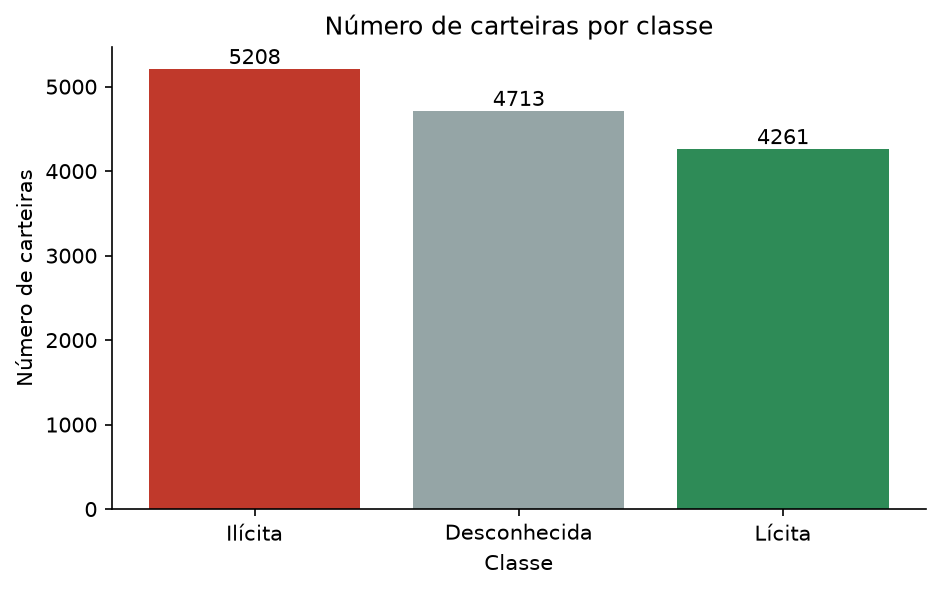
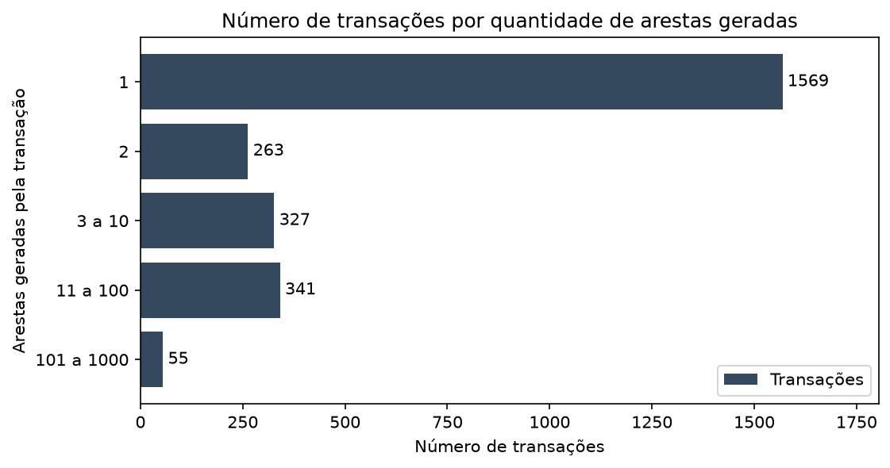
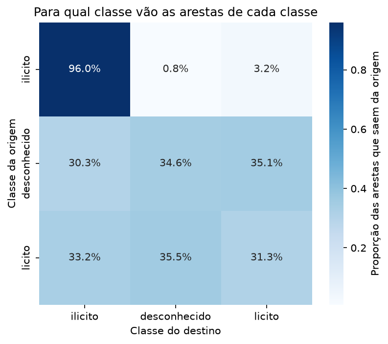
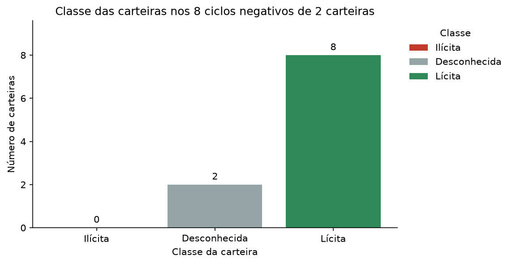
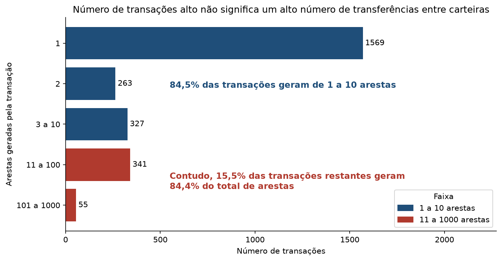
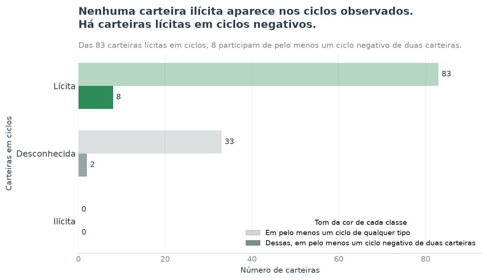

<!-- [IA] Claude Code – esqueleto do relatório: seções tiradas do enunciado, partes factuais preenchidas a partir do repositório; análises, discussões, prova e conclusões ficam para o grupo -->

# Projeto Final — Teoria dos Grafos + AVD (2026.2)

**Labirinto com Chaves (Grafo de Estados) + Comparação de Algoritmos no Elliptic++**

Matheus Araujo · Thomaz Lima · Davi Marques Oliveira · Vagner Montenegro de Melo

Repositório: <https://github.com/davimqz/Projetos-Grafos> · Entrega: 26/11/2026

> **Como usar este esqueleto.** Cada bloco marcado com **[A ESCREVER]** diz o que o enunciado pede e quem é o dono.
> Pelas regras de IA, análises, discussões, conclusões, notas analíticas e a prova do m05 têm que ser escritas por
> nós; a IA só pode revisar ortografia e clareza depois. Apagar este aviso e os marcadores antes de gerar o PDF.

---

## Sumário

1. Introdução
2. Manual de uso
3. Implementação comum (grafo e algoritmos)
4. Parte 1 — Labirinto com Chaves
5. Parte 2 — Elliptic++
6. AVD — análise exploratória e explanatória
7. Testes
8. Limitações
9. Conclusões
10. Matriz de contribuição
11. Uso de IA

---

## 1. Introdução

Este projeto tem como objetivo implementar, do zero e sem o uso de bibliotecas especializadas em algoritmos de grafos,
as estratégias de busca em largura (BFS), busca em profundidade (DFS), Dijkstra e Bellman-Ford, aplicando-as a dois
problemas distintos. A primeira parte aborda a resolução de labirintos com mecânicas adicionais, como chaves, portas,
esteiras, bônus e fontes de energia. Nesse contexto, cada posição do mapa pode representar diferentes estados,
dependendo das chaves coletadas e dos bônus já consumidos durante o percurso. Foram utilizados oito mapas
disponibilizados pelo enunciado, incluindo o maior deles, de dimensões 31 × 71, além de dois mapas desenvolvidos pelo
grupo. A segunda parte utiliza o conjunto de dados Elliptic++, que representa uma rede de transações Bitcoin composta
originalmente por 822.942 carteiras e aproximadamente 2,87 milhões de arcos, da qual foi extraído um recorte com
14.182 carteiras e 25.111 arcos para análise.

A partir desse segundo problema, busca-se investigar a seguinte questão: **carteiras ilícitas participam mais de
ciclos de repasse (ciclos negativos) do que as lícitas?** Para isso, aplicam-se os algoritmos implementados ao recorte,
usando o saldo da carteira de destino como peso dos arcos, o que permite valores negativos, e a análise exploratória e
explanatória dos dados complementa a investigação. O relatório está organizado em seções que apresentam o manual de
utilização, os detalhes da implementação, os resultados da aplicação dos algoritmos nas duas partes do projeto, a
análise e visualização dos dados (AVD), os testes realizados, as limitações identificadas, as conclusões obtidas, a
matriz de contribuição dos integrantes do grupo e, por fim, o uso de IA.

---

## 2. Manual de uso

### 2.1 Instalação

Python 3.11 ou mais novo.

```bash
git clone https://github.com/davimqz/Projetos-Grafos.git
cd Projetos-Grafos
python -m venv .venv
# Windows: .venv\Scripts\activate   |   Linux/macOS: source .venv/bin/activate
pip install -r requirements.txt
pytest
```

O recorte da Parte 2 já está em `data/dataset_parte2/`; não é preciso baixar o dataset.

### 2.2 Parte 1

```bash
python -m src.cli --mapa ./data/mapas/m03_tres_chaves.txt --alg BFS --out ./out/parte1/
python -m src.cli --mapa ./data/mapas/m03_tres_chaves.txt --alg DIJKSTRA --out ./out/parte1/
python -m src.cli --mapa ./data/mapas/m05_bonus.txt --alg BELLMAN_FORD --out ./out/parte1/
python -m src.cli --mapa ./data/mapas/m06_fonte.txt --alg BELLMAN_FORD --fonte-consumivel --out ./out/parte1/
python -m src.cli --mapa ./data/mapas/m04_esteiras.txt --armadilhas --out ./out/parte1/
python -m src.cli --mapa ./data/mapas/m03_tres_chaves.txt --interactive --out ./out/parte1/
python -m src.visualizar_parte1 --out ./out/parte1/
```

> **[COMPLETAR — Matheus]** Comando que gera as saídas do P3 (`solve.py`) quando entrar na main.

### 2.3 Parte 2

```bash
python -m src.cli --dataset ./data/dataset_parte2/ --alg BFS --source <carteira> --out ./out/parte2/
python -m src.cli --dataset ./data/dataset_parte2/ --alg DFS --source <carteira> --out ./out/parte2/
python -m src.cli --dataset ./data/dataset_parte2/ --alg DIJKSTRA --source <carteira> --target <carteira> --out ./out/parte2/
python -m src.cli --dataset ./data/dataset_parte2/ --alg BELLMAN_FORD --source <carteira> --out ./out/parte2/
python -m src.cli --dataset ./data/dataset_parte2/ --benchmark --out ./out/parte2/
```

### 2.4 Labirinto interativo

> **[A ESCREVER — Thomaz]** Como abrir o `out/parte1/html/labirinto_interativo.html` e o que cada controle faz (seleção de
> mapa e algoritmo, passo a passo, velocidade, camadas, armadilhas). Incluir 1 captura de tela.

### 2.5 Front-end em React (extra)

```bash
python -m scripts.exportar_front
cd front-react && npm install && npm run dev
```

> **[A ESCREVER — Vagner]** Uma frase sobre o que o front mostra e 1 captura de tela.

---

## 3. Implementação comum (grafo e algoritmos)

Os algoritmos estão em `src/graphs/algorithms.py`, sobre a lista de adjacência dirigida de `src/graphs/graph.py`
(vizinhos na ordem N, L, S, O). As mesmas funções são usadas nas duas partes. O `networkx` aparece só em `tests/`,
como oráculo.

| Algoritmo | Entrada | Saída | Complexidade |
|---|---|---|---|
| BFS | grafo, origem | ordem, nível de cada nó, árvore | O(V + E) |
| DFS | grafo, origem | ordem, arcos de árvore/retorno/avanço/cruzamento, existência de ciclo | O(V + E) |
| Dijkstra (`heapq`) | grafo com pesos ≥ 0, origem | distâncias e caminho; recusa peso negativo | O((V + E) log V) |
| Bellman-Ford | grafo, origem | distâncias e caminho, ou o ciclo negativo reconstruído | O(V · E) |

> **[A ESCREVER — Thomaz]** Decisões de implementação que valem explicar: como a DFS classifica cada arco (tempos de
> descoberta/término), como o Dijkstra recusa peso negativo, como o Bellman-Ford reconstrói o ciclo.

---

## 4. Parte 1 — Labirinto com Chaves

### 4.1 Modelagem: G_pos e G_est

> **[A ESCREVER — Matheus]** O que é um nó em cada grafo, o rótulo `(l,c)|chaves|{bônus}`, a numeração dos bônus em
> ordem de leitura, a construção por exploração a partir de `S`, o nó `ALVO` com arco de custo 0 e as variantes
> (portas como chão/parede, `+` fixo, fonte consumível). Incluir o G_est do m02 desenhado à mão.

### 4.2 Por que o grafo tem que ser dirigido

> **[A ESCREVER — Matheus]** Exigido pelo enunciado (Seção 2). Pensar em esteiras e em pegar uma chave.

### 4.3 Mapa mínimo contado à mão

> **[A ESCREVER — Matheus]** O mapa de até 5×7 usado em `tests/test_estados.py`, com o número de estados e de arcos
> contado à mão e a indicação do teste que confere.

### 4.4 Métricas globais e por camada

Fonte: `out/parte1/json/metricas_global.json` e `out/parte1/json/camadas.json`.

| Mapa | G_pos: ordem | tamanho | densidade | G_est: ordem | tamanho | densidade | teto teórico | ocupação |
|---|---|---|---|---|---|---|---|---|
| m01 … m08 | | | | | | | | |

> **[A ESCREVER — Matheus]** Comentário da tabela, métricas por camada, quantos arcos ligam camadas e **por que são
> exatamente aquelas casas**.

### 4.5 Graus, multiplicidade e becos

Fonte: `out/parte1/csv/graus_<mapa>.csv`, `out/parte1/figuras/heatmap_m08.png`.

> **[A ESCREVER — Matheus]** Maior grau de entrada e de saída por mapa; multiplicidade máxima no m08, quantas casas a
> atingem e por quê; becos encontrados.

### 4.6 Comparação de modelagens (m02, m03, m04)

Fonte: `out/parte1/csv/comparacao_modelagem.csv`.

| Mapa | Abordagem | Passos | Caminho válido | Observação |
|---|---|---|---|---|
| | portas como chão | | | |
| | portas como parede | | | |
| | G_est | | | |

> **[A ESCREVER — Matheus]** Por que (a) gera caminho inválido e (b) falha.

### 4.7 m05: pesos negativos e a prova

Fonte: Bellman-Ford no G_pos com `+` fixo em −4 × no G_est.

> **[A ESCREVER — Matheus]** Resultado dos dois casos e a **prova** de que o G_est do m05 não tem ciclo negativo
> (dica do enunciado: o que acontece com o conjunto de bônus ao longo de um caminho?).

### 4.8 Caminhos nos mapas

Fonte: `out/parte1/csv/solucoes.csv`, `out/parte1/csv/dfs_classificacao.csv`, `out/parte1/json/percurso_m03.json`.

| Mapa | BFS (passos) | Dijkstra (custo / status) | Bellman-Ford | DFS: árvore / retorno / avanço / cruzamento |
|---|---|---|---|---|
| m01 … m08, mapas do grupo | | | | |

> **[A ESCREVER — Matheus e Thomaz]** Discussões obrigatórias:
> - **m01:** por que BFS e Dijkstra dão caminhos diferentes;
> - **m06:** o ciclo negativo (sequência de estados e custo, de `ciclo_negativo_m06.json`), a correção com
>   `--fonte-consumivel` e o resultado finito do Bellman-Ford;
> - **m07:** como a busca mostra que não há solução e quantos estados são alcançáveis.

### 4.9 Estados-armadilha (m04 e m07)

Fonte: `out/parte1/csv/armadilhas_m04.csv`, `out/parte1/csv/armadilhas_m07.csv`.

> **[A ESCREVER — Matheus]** Método (busca a partir de `ALVO` no grafo transposto), quantos estados são armadilha e
> exemplos.

### 4.10 Mapas do grupo

Fonte: `data/mapas_grupo/`.

| Mapa | Estados | Arcos | Passos (BFS) | Custo (Dijkstra ou BF) | % armadilhas |
|---|---|---|---|---|---|
| mapa 1 (≥ 3 chaves, esteira e bônus no caminho ótimo) | | | | | |
| mapa 2 (≥ 20% de armadilhas) | | | | | |

> **[A ESCREVER — Matheus]** Desenho de cada mapa e o que ele exercita.

### 4.11 Visualizações

Figuras em `out/parte1/figuras/`:

- `percurso_m03.png` e `percurso_m08.png`: percurso de menor custo, com a cor mudando a cada chave;
- `camadas_m02.png`: G_est do m02 por camada, destacando os arcos entre camadas;
- `arvore_bfs_m02.png`: árvore BFS do m02 com os níveis;
- `heatmap_m08.png`: multiplicidade das casas do m08.

> **[A ESCREVER — Thomaz]** Inserir as figuras com legenda e uma frase sobre o que cada uma mostra.

---

## 5. Parte 2 — Elliptic++

> O conteúdo detalhado já está em [`parte2.md`](parte2.md) e em [`../PARTE2_DATASET.md`](../PARTE2_DATASET.md).
> Aqui entra a versão final, resumida, para o PDF.

### 5.1 Dataset e recorte

Fonte: Elliptic++ (<https://github.com/git-disl/EllipticPlusPlus>), grafo de carteiras (endereço → endereço).

| | Grafo completo | Recorte usado |
|---|---|---|
| Carteiras (nós) | 822.942 | 14.182 |
| Arcos | 2.868.964 | 25.111 |
| Tipo | dirigido | dirigido, ponderado |

Recorte em bola de neve a partir de 50 carteiras ilícitas sorteadas (seed 42), expandindo por vizinhos de entrada e
saída até pelo menos 25.000 arestas no subgrafo induzido. Laços removidos (45.981) e arestas repetidas agregadas em um
arco por par.

Na preparação dos dados, removemos os laços (A → A), pois representam troco e poderiam gerar ciclos negativos artificiais. Também agregamos arestas repetidas entre as mesmas carteiras, somando os valores das transações para o Dijkstra, e mantivemos uma única linha por carteira, já que o dataset repete em cada intervalo de tempo (time step) os totais da vida inteira da carteira; somar essas linhas contaria o mesmo valor várias vezes. Para reduzir o tamanho do grafo, aplicamos um recorte em bola de neve, partindo das carteiras ilícitas e expandindo para seus vizinhos. Essa estratégia preserva as conexões, ao contrário da amostragem aleatória. O recorte foi necessário porque o grafo completo possui 2,87 milhões de arestas, acima do limite de aproximadamente 500 mil arestas a partir do qual o enunciado exige amostragem.

#### Caracterização estrutural e distribuição dos graus

O grafo analisado é direcionado e composto por 14.182 vértices (carteiras) e 25.111 arcos (pares de carteiras que transacionaram entre si). A análise da distribuição dos graus de entrada e saída revela uma concentração de conexões em valores baixos, acompanhada pela presença de algumas carteiras com número expressivamente elevado de conexões. Considerando o conjunto completo, ambos os tipos de grau apresentam média de 1,77. Entretanto, as medianas diferem: o grau de entrada possui mediana igual a zero, enquanto o grau de saída apresenta mediana igual a um. Essa diferença também é observada na quantidade de carteiras sem conexões: 8.021 (56,6%) têm grau de entrada zero, enquanto 2.089 (14,7%) têm grau de saída zero.

A distribuição também apresenta diferenças entre as classes. No grau de entrada, as carteiras ilícitas possuem mediana igual a um, enquanto as lícitas e desconhecidas apresentam mediana igual a zero. Além disso, 37,3% das carteiras ilícitas não possuem conexões de entrada, proporção consideravelmente inferior à observada nas classes desconhecida (67,4%) e lícita (68,1%). No grau de saída, as três classes apresentam mediana igual a um, mas a proporção de carteiras sem conexões de saída varia: 8,2% entre as ilícitas, 10,9% entre as desconhecidas e 27,0% entre as lícitas.

Outro aspecto relevante é a presença de carteiras com graus muito superiores aos valores predominantes na rede. No grau de entrada, o maior valor identificado pertence a uma carteira desconhecida, com 2.719 conexões, seguida por uma carteira ilícita, com 1.996. Entre as lícitas, o maior grau de entrada é 162. Para o grau de saída, os maiores valores também pertencem às classes desconhecida e ilícita, com 1.002 e 398 conexões, respectivamente, enquanto a carteira lícita de maior grau de saída apresenta 71 conexões. Esses valores evidenciam a existência de vértices com elevada concentração de conexões, que se destacam em relação à distribuição predominante.

As Figuras 5.1 e 5.2 apresentam, respectivamente, a distribuição dos graus por meio de histogramas e da distribuição acumulada complementar (CCDF), considerando as três classes de carteiras. A utilização de escalas logarítmicas permite visualizar diferentes ordens de magnitude, enquanto a CCDF complementa os histogramas ao demonstrar a proporção de carteiras que alcança ou supera determinado valor de grau. Em conjunto, as representações permitem observar tanto a concentração de conexões em graus menores quanto o comportamento das distribuições nas faixas de graus mais elevados.


*Figura 5.1 — Distribuição dos graus de entrada e de saída por classe, em escala log-log com faixas de base 2. O eixo vertical é a proporção das carteiras da classe; as carteiras com grau zero estão na tabela abaixo dos gráficos.*


*Figura 5.2 — Distribuição acumulada complementar (CCDF) dos graus por classe: proporção das carteiras da classe com grau maior ou igual a k, em escala log-log.*

Por fim, a caracterização evidencia diferenças estruturais entre as classes, especialmente na quantidade de carteiras sem conexões e na presença de vértices com graus elevados. Essas características são relevantes para contextualizar as análises posteriores de caminhos e ciclos na rede, sem implicar, por si só, qualquer relação direta entre o número de conexões e a participação em ciclos negativos.

Os números vêm de `out/parte2/graus_resumo.json` e `out/parte2/graus_zero.csv`, gerados por `python -m scripts.graus_parte2`.

### 5.2 Pesos, caminho mínimo e ciclo negativo

| Peso | Algoritmo | Definição |
|---|---|---|
| `valor_btc` | Dijkstra | soma do `total_BTC` das transações do par A → B (≥ 0) |
| saldo do destino | Bellman-Ford | `btc_received_total − btc_sent_total` da carteira B |

No Bellman-Ford, utilizamos como peso o saldo da carteira de destino (B), calculado pela diferença entre o total de BTC recebidos e enviados. Como o dataset não possui pesos nas arestas e os valores das transações são sempre não negativos, o saldo é a única grandeza que permite obter valores negativos sem inventá-los. Um saldo positivo indica acúmulo de BTC, enquanto um negativo indica que a carteira envia mais do que recebe. Não usamos a diferença entre os saldos de A e B porque, nesse caso, a soma dos pesos em qualquer ciclo seria sempre zero, impossibilitando a identificação de ciclos negativos. Assim, esses ciclos podem indicar padrões de circulação de fundos entre carteiras, que são o foco da pesquisa. Utilizamos o grafo de carteiras porque o grafo de transações não possui ciclos, já que cada transação depende de saídas anteriores.

No Dijkstra, utilizamos como peso a soma dos valores das transações entre A e B (valor_btc), pois ela já existe no dataset e é não negativa. Dessa forma, o caminho mínimo representa a rota com a menor soma dos valores movimentados.

**Pergunta de pesquisa:** carteiras ilícitas participam mais de ciclos de repasse (ciclos negativos) do que as lícitas?

### 5.3 BFS e DFS (3 fontes)

Fonte: `out/parte2/bfs_*.json`, `out/parte2/dfs_*.json`.

#### Escolha das carteiras analisadas

Foram selecionadas três carteiras para a análise: uma ilícita, uma lícita e uma desconhecida.

A seleção foi feita a partir das **5 carteiras com maior número de arcos de saída de cada classe**. O objetivo foi comparar a estrutura das redes alcançáveis a partir dessas fontes.

##### Carteira ilícita

- **Endereço:** `39sfuA8pY4UfybgEZi7uvA13jkGzZpsg5K`
- **Arcos de saída:** 398.
- **Critério de seleção:** maior número de arcos de saída entre as 5 carteiras ilícitas listadas.
- **BFS:** alcançou 1.737 carteiras, incluindo a origem, distribuídas em 8 camadas.
- **DFS:** identificou arcos de retorno, indicando ciclos na região alcançável.

##### Carteira lícita

- **Endereço:** `35fNF5Uwbsoa5ABPCUvKZNyuAV7S9sJTou`
- **Arcos de saída:** 71.
- **Critério de seleção:** maior número de arcos de saída entre as 5 carteiras lícitas listadas.
- **BFS:** alcançou 81 carteiras, incluindo a origem, distribuídas em 3 camadas.
- **DFS:** não identificou arcos de retorno na região alcançável.

##### Carteira desconhecida

- **Endereço:** `1MFXYK1XucKFfhPhW9HDHD3vsM9BKey4qm`
- **Arcos de saída:** 1.002.
- **Critério de seleção:** maior número de arcos de saída entre as 5 carteiras desconhecidas listadas.
- **BFS:** alcançou 1.267 carteiras, incluindo a origem, distribuídas em 7 camadas.
- **DFS:** identificou arcos de retorno, indicando ciclos na região alcançável.

A carteira permanece classificada como desconhecida, pois os resultados estruturais não permitem determinar sua classificação.

#### BFS — Busca em Largura

A BFS (Busca em Largura) permite analisar quantas carteiras podem ser alcançadas a partir de uma carteira inicial e a distância de cada uma em relação à origem.

A exploração ocorre por camadas: primeiro são analisadas as conexões mais próximas, depois as conexões seguintes e assim por diante.

Neste trabalho, **a contagem inclui a própria carteira de origem, identificada como camada 0**. Portanto, o total de carteiras alcançadas também inclui a origem.

##### Resultados gerais

| Classe | Carteiras alcançadas, incluindo a origem | Camadas, incluindo a origem | Distância máxima |
|---|---:|---:|---:|
| Ilícita | 1.737 | 8 | 7 |
| Lícita | 81 | 3 | 2 |
| Desconhecida | 1.267 | 7 | 6 |

A carteira ilícita apresentou o maior alcance entre as três fontes analisadas, com 1.737 carteiras.

A carteira desconhecida alcançou 1.267 carteiras, enquanto a carteira lícita apresentou um alcance menor, com 81 carteiras.

Esses resultados mostram diferenças na extensão das regiões alcançáveis a partir das fontes selecionadas.

##### Distribuição das carteiras por camada

A tabela abaixo mostra como as carteiras alcançadas estão distribuídas em cada camada da BFS. Cada linha representa a quantidade de carteiras encontradas a uma determinada distância da origem.

| Camada | Ilícita | Lícita | Desconhecida |
|---|---:|---:|---:|
| 0 — Origem | 1 | 1 | 1 |
| 1 | 398 | 71 | 1.002 |
| 2 | 90 | 9 | 141 |
| 3 | 988 | — | 19 |
| 4 | 149 | — | 17 |
| 5 | 17 | — | 56 |
| 6 | 63 | — | 31 |
| 7 | 31 | — | — |
| **Total** | **1.737** | **81** | **1.267** |

##### Interpretação da distribuição

A carteira ilícita apresenta uma expansão expressiva na terceira camada, com 988 carteiras encontradas nessa distância. Isso indica que uma parcela significativa do seu alcance está concentrada a três conexões da origem.

A carteira lícita apresenta uma rede mais curta: são 71 carteiras na primeira camada e 9 na segunda. Como a origem também é contabilizada, o total alcançado é de 81 carteiras em 3 camadas.

A carteira desconhecida apresenta uma concentração muito elevada na primeira camada, com 1.002 carteiras diretamente alcançáveis a partir da origem. Nas camadas seguintes, a quantidade de carteiras diminui significativamente em relação à primeira camada, embora apresente algumas oscilações ao longo da expansão, como o aumento de 17 para 56 carteiras na camada 5.

Essas diferenças mostram que não basta observar o alcance total: a distribuição por camada também ajuda a compreender como cada rede se expande.

#### DFS — Busca em Profundidade

A DFS (Busca em Profundidade) explora um caminho do grafo até onde for possível antes de retornar e investigar outras conexões.

Durante a execução, os arcos são classificados em quatro categorias:

| Classe | Árvore | Retorno | Avanço | Cruzamento |
|---|---:|---:|---:|---:|
| Ilícita | 1.736 | 103 | 194 | 549 |
| Lícita | 80 | 0 | 0 | 30 |
| Desconhecida | 1.266 | 98 | 253 | 450 |

##### Significado dos arcos

- **Árvore:** arcos utilizados para descobrir novos vértices durante a DFS.
- **Retorno:** arcos que conectam um vértice a um de seus ancestrais na árvore DFS. Em grafos direcionados, indicam a presença de ciclos.
- **Avanço:** arcos que conectam um ancestral a um descendente já descoberto, sem terem sido utilizados para descobrir esse descendente.
- **Cruzamento:** arcos entre vértices que não possuem relação direta de ancestralidade na árvore DFS.

##### Interpretação

A carteira ilícita apresentou 103 arcos de retorno, enquanto a desconhecida apresentou 98.

Isso indica que **as regiões alcançáveis a partir dessas carteiras possuem ciclos**.

Já a carteira lícita não apresentou arcos de retorno, indicando que não foram identificados ciclos em sua região alcançável durante a execução da DFS.

É importante destacar que encontrar ciclos na região alcançável não significa que a carteira de origem participa diretamente deles. Essa distinção será importante para responder à pergunta de pesquisa.

### 5.4 Dijkstra (5 pares)

Fonte: `out/parte2/dijkstra_*.json`.

<!-- [IA] Claude Code – estrutura da seção, tabelas montadas a partir dos JSONs de out/parte2/ e transcrição literal das justificativas escritas pelo Davi. As interpretações foram escritas pelo Davi. -->

#### Critérios de escolha

##### Bellman-Ford

- **Caso com ciclo negativo:** carteira desconhecida `1MFXYK1XucKFfhPhW9HDHD3vsM9BKey4qm`, a mesma usada no BFS e na DFS.
- **Caso sem ciclo negativo:** escolher a carteira lícita `3Fzzji5nFaSptmYL8bNsm3KcpYm3qnxqBS`, pois, entre as carteiras que atendem ao requisito de pesos negativos sem ciclo negativo, é a que alcança a maior quantidade de arcos negativos (29).

##### Dijkstra

Peso: `valor_btc`, a soma dos valores das transações entre as duas carteiras (ver "Design dos pesos").

Quero analisar cinco combinações: Ilícita → Ilícita; Ilícita → Lícita; Lícita → Ilícita; Desconhecida → Ilícita; Ilícita → Desconhecida. O objetivo é comparar a circulação entre as classes e investigar principalmente as relações entre carteiras lícitas e ilícitas, considerando os dois sentidos das conexões.

As origens são as mesmas carteiras usadas no BFS e na DFS.

**Critério do destino:** selecionar o primeiro destino da classe desejada na ordem de visita do BFS, desde que esteja a pelo menos 3 passos da origem. Assim, conseguimos analisar trajetórias com carteiras intermediárias, em vez de considerar apenas transferências diretas.

**Origem do par Lícita → Ilícita:** a carteira lícita usada no BFS só alcança carteiras ilícitas a até 2 passos. Utilizar outra carteira lícita como origem mantém o critério de pelo menos 3 passos uniforme entre as combinações do Dijkstra, evitando uma exceção metodológica. Para selecionar a origem: escolher a carteira lícita que alcança o maior número de carteiras ilícitas a partir de 3 passos de distância. Em caso de empate, utilizar a que apresentar a maior distância mínima média até os destinos ilícitos selecionados.

Como as cinco carteiras empataram nos dois primeiros critérios (quantidade de destinos ilícitos alcançados e distância média), utilizamos o número de transações como terceiro critério de desempate. Isso privilegia a carteira com maior atividade transacional e oferece uma origem mais representativa para a análise de caminhos.

#### Resultados do Dijkstra

| Par | Origem | Destino | Custo (BTC) | Arcos | Caminho |
|---|---|---|---|---|---|
| Ilícita → Ilícita | `39sfuA8p…` | `17uQbqBG…` | 26,55 | 5 | `39sfuA8p` → `1MLvzsdb` → `1FAv42Ga` → `16PaWFJt` → `1MFXYK1X` → `17uQbqBG` |
| Ilícita → Lícita | `39sfuA8p…` | `16PaWFJt…` | 10,88 | 3 | `39sfuA8p` → `1MLvzsdb` → `1FAv42Ga` → `16PaWFJt` |
| Lícita → Ilícita | `3MTTgd2B…` | `17tqJV8U…` | 49,95 | 4 | `3MTTgd2B` → `1KNd3pk9` → `3Fp5ejYY` → `3AhpkBp2` → `17tqJV8U` |
| Desconhecida → Ilícita | `1MFXYK1X…` | `1GeFfWdv…` | 59,81 | 3 | `1MFXYK1X` → `1LVQMGJ9` → `14GA7Uy9` → `1GeFfWdv` |
| Ilícita → Desconhecida | `39sfuA8p…` | `1J5U1rN5…` | 5,54 | 3 | `39sfuA8p` → `1MLvzsdb` → `1FAv42Ga` → `1J5U1rN5` |

Endereços completos e peso de cada arco: `out/parte2/dijkstra_<origem>_<destino>.json`.

##### Interpretação dos resultados do Dijkstra

A aplicação do algoritmo de Dijkstra permitiu identificar os caminhos de menor custo entre cinco pares de carteiras de diferentes classificações, utilizando `valor_btc` como peso das arestas. Os custos encontrados variaram entre 5,54 BTC e 59,81 BTC, evidenciando diferenças nas trajetórias de circulação de recursos entre as classes analisadas.

Na comparação entre os pares Lícita → Ilícita e Ilícita → Lícita, foram observados custos de 49,95 BTC e 10,88 BTC, respectivamente. É importante destacar que se trata de pares distintos de carteiras, com origens e destinos diferentes, e não da inversão de um mesmo trajeto. Portanto, a diferença evidencia características específicas dos caminhos selecionados, mas não permite estabelecer uma assimetria geral na circulação entre essas classes.

Outro aspecto observado foi a repetição da sequência de carteiras `39sfuA8p → 1MLvzsdb → 1FAv42Ga` em três caminhos que partem de uma origem ilícita. Essa recorrência sugere que esses endereços desempenham um papel de intermediação na rede, funcionando como pontos de passagem compartilhados por diferentes trajetórias. A presença dessas carteiras em múltiplos caminhos indica uma possível concentração da circulação em determinados endereços, que podem atuar como pontes entre diferentes regiões do grafo. Contudo, essa observação, isoladamente, não comprova que sejam os principais pontos de intermediação da rede, sendo necessária uma análise estrutural complementar para confirmar essa hipótese.

O caminho identificado pelo Dijkstra reforça uma conexão que já estava presente nos resultados do BFS: a carteira desconhecida `1MFXYK1X` é alcançável a partir da origem ilícita. A análise do caminho de menor custo permitiu destacar essa relação, evidenciando a conexão entre as regiões exploradas.

A comparação entre o número de arcos também demonstra que o caminho de menor custo não corresponde necessariamente ao caminho com menor quantidade de transferências. No par Ilícita → Ilícita, por exemplo, o destino estava a três passos da origem na exploração por BFS, mas o caminho selecionado pelo Dijkstra utilizou cinco arcos. Isso ocorre porque o Dijkstra prioriza a soma dos pesos das arestas, podendo selecionar uma trajetória com mais etapas quando ela apresenta um custo acumulado inferior.

É importante considerar, entretanto, que `valor_btc` representa o valor integral de cada transação, e não necessariamente o montante efetivamente transferido entre a carteira de origem e a carteira de destino. Dessa forma, o custo acumulado representa a soma dos valores associados às transações que compõem o caminho, não devendo ser interpretado como uma medida exata do volume transferido entre os endereços. Além disso, a análise contempla apenas cinco pares de carteiras, de modo que os resultados representam exemplos de trajetórias possíveis na rede, não sendo suficientes para estabelecer padrões gerais de circulação entre as diferentes classes.

### 5.5 Bellman-Ford

Fonte: `out/parte2/bellman_ford_*.json`.

#### Resultados do Bellman-Ford

<!-- [IA] Claude Code – tabelas atualizadas a partir de out/parte2/bellman_ford_*.json regenerado pelo Davi em 24/11 (depois do PR #49); sem interpretação -->

| Caso | Origem | Status | Resultado |
|---|---|---|---|
| Sem ciclo negativo | `3Fzzji5n…` (lícita) | OK | 45 carteiras alcançadas (incluindo a origem), 29 arcos negativos alcançáveis; distâncias de −0,26 a 36,36; 5 carteiras com distância negativa |
| Com ciclo negativo | `1MFXYK1X…` (desconhecida) | CICLO_NEGATIVO | 1.162 carteiras alcançadas até a parada; ciclo de 3 carteiras: `1MFXYK1XucKFfhPhW9HDHD3vsM9BKey4qm` → `3GwfdNG4KVx6pt6s8mNje85GTA5kH1f73q` → `1MFcDAzG1CJaCqY6BGU2LACzeCLFnfmjsh` → `1MFXYK1X…` |

Arcos do ciclo negativo:

| Arco | Peso (saldo do destino) |
|---|---|
| `1MFXYK1X…` → `3GwfdNG4…` | −3,38 |
| `3GwfdNG4…` → `1MFcDAzG…` | 0,01 |
| `1MFcDAzG…` → `1MFXYK1X…` | −1.674,02 |
| **Custo do ciclo** | **−1.677,39** |

Carteiras do ciclo (`data/dataset_parte2/nos.csv`):

| Carteira | Classe | Transações | Recebido (BTC) | Enviado (BTC) | Saldo (BTC) |
|---|---|---:|---:|---:|---:|
| `1MFXYK1X…` | desconhecida | 218 | 919,43 | 2.593,45 | −1.674,02 |
| `3GwfdNG4…` | desconhecida | 15 | 0,20 | 3,58 | −3,38 |
| `1MFcDAzG…` | lícita | 3 | 0,05 | 0,04 | 0,01 |

Resultados completos: `out/parte2/bellman_ford_<origem>.json`.

##### Interpretação dos resultados do Bellman-Ford

A aplicação do algoritmo de Bellman-Ford permitiu investigar a existência de ciclos negativos na rede, utilizando como peso das arestas o saldo da carteira de destino, calculado pela diferença entre os valores recebidos e enviados. Nesse modelo, arcos negativos representam conexões cujo destino apresenta saldo negativo, enquanto ciclos negativos representam estruturas nas quais a soma dos pesos das arestas do circuito também é negativa.

**Caso 1: origem lícita (`3Fzzji5n…`)**

Na execução iniciada pela carteira lícita, o algoritmo terminou normalmente, sem identificar ciclos negativos alcançáveis. Foram alcançadas 45 carteiras, com passagem por 29 arcos negativos. Além disso, cinco carteiras apresentaram distâncias acumuladas negativas.

Esse resultado demonstra que a presença de arcos negativos não implica necessariamente a formação de ciclos de repasse. Uma carteira pode apresentar saldo negativo e estar conectada a outras carteiras com a mesma característica sem que exista um caminho direcionado de retorno que forme um circuito negativo. Nesse caso, os arcos negativos aparecem em trajetórias que não constituem ciclos negativos alcançáveis pela origem analisada.

As cinco distâncias negativas também indicam que existem trajetórias cujo custo acumulado, segundo os pesos definidos, permanece abaixo de zero. Isso reforça a distinção entre alcançar carteiras por caminhos de custo negativo e identificar efetivamente uma estrutura cíclica. Portanto, a ausência de ciclos negativos nessa execução não significa ausência de comportamentos de repasse, mas demonstra que os arcos negativos encontrados não formaram um ciclo negativo alcançável a partir daquela origem.

**Caso 2: origem desconhecida (`1MFXYK1X…`)**

O ciclo negativo identificado a partir da carteira `1MFXYK1X…` apresentou custo total de −1.677,39. Observa-se que o arco de entrada dessa carteira possui peso de −1.674,02, representando aproximadamente 99,8% do custo total do ciclo. Essa concentração evidencia a influência expressiva de um único peso sobre o resultado, embora os demais arcos também componham o custo final. Inclusive, um dos arcos apresenta peso positivo (+0,01), demonstrando que um ciclo negativo não exige que todos os seus arcos tenham pesos negativos, mas apenas que a soma dos pesos seja inferior a zero.

Esse comportamento está relacionado ao saldo da carteira `1MFXYK1X…`, que apresenta o segundo valor mais negativo entre as carteiras do recorte. Assim, o resultado deve ser interpretado considerando a concentração do custo em um arco específico, evitando atribuir à totalidade do ciclo uma característica que decorre predominantemente de um único componente.

**Relação com a pergunta de pesquisa**

Os resultados obtidos pelo algoritmo de Bellman-Ford permitem observar comportamentos distintos entre as carteiras analisadas, mas não sustentam a hipótese de que carteiras ilícitas participam mais de ciclos negativos do que carteiras lícitas.

No caso da carteira `3Fzzji5n…`, classificada como lícita, o algoritmo não identificou ciclos negativos alcançáveis a partir da origem, apesar da existência de arcos com pesos negativos. Esse resultado demonstra que a presença de arcos com pesos negativos, isoladamente, não caracteriza a existência de um ciclo negativo.

Por outro lado, na análise da carteira `1MFXYK1X…`, classificada como desconhecida, foi identificado um ciclo negativo composto por três carteiras: duas classificadas como desconhecidas (`1MFXYK1X…` e `3GwfdNG4…`) e uma classificada como lícita (`1MFcDAzG…`). Nesse caso, a própria carteira de origem participa do ciclo, uma vez que está presente na sequência de vértices que fecha o circuito.

O ciclo apresentou custo total de −1.677,39. Um dos arcos, aquele que entra na carteira `1MFXYK1X…`, apresentou peso de −1.674,02, correspondendo a aproximadamente 99,8% do custo total. Também foi identificado um arco com peso positivo (+0,01), o que não invalida a classificação do ciclo como negativo, uma vez que essa classificação depende da soma dos pesos de todos os seus arcos.

É importante observar que a carteira `1MFXYK1X…` possui o segundo saldo mais negativo do recorte analisado. Portanto, a magnitude do custo encontrado está fortemente relacionada a uma característica específica dessa carteira, e não necessariamente a um padrão recorrente de comportamento das carteiras envolvidas.

Dessa forma, os resultados individuais do Bellman-Ford não permitem estabelecer uma relação direta entre a classificação de uma carteira e sua participação em ciclos negativos. Para responder à pergunta de pesquisa de maneira mais abrangente dentro do recorte, é necessário considerar também a análise estrutural realizada sobre o grafo completo, apresentada na seção 6.4.

### 5.6 Desempenho e escalabilidade

Fonte: `out/parte2/parte2_report.json`, `out/parte2/benchmark_escalabilidade.png`.

Para cada algoritmo e tamanho de amostra, medimos o tempo de cinco execuções com `timeit`. A tabela apresenta a média dessas execuções. Para a amostra de 100%, mostramos também a latência mínima e máxima, ou seja, quanto duraram a execução mais rápida e a mais lenta das cinco. Os intervalos das outras amostras estão em `out/parte2/parte2_report.json`. Medimos o pico de memória alocada pelo Python com `tracemalloc` em uma execução separada, sem contar a memória do grafo, que já estava carregado. O carregamento e a amostragem ficaram fora das medições.

As porcentagens de 10%, 50% e 100% se referem aos vértices do recorte. Cada amostra mantém os arcos cujas duas extremidades foram selecionadas. A amostra de 10% ficou com 1.418 vértices e 130 arcos, a de 50% com 7.091 vértices e 6.477 arcos, e a de 100% com 14.182 vértices e 25.111 arcos.

| Algoritmo | Média 10% (ms) | Média 50% (ms) | Média 100% (ms) | Latência 100% (ms) | Pico de memória em 10% / 50% / 100% (KiB) | Complexidade |
|---|---:|---:|---:|---:|---|---|
| BFS | 0,36 | 2,48 | 6,03 | 4,33 a 8,85 | 270 / 1.131 / 2.265 | O(V + E) |
| DFS | 0,88 | 6,31 | 21,77 | 17,42 a 24,82 | 306 / 1.693 / 4.380 | O(V + E) |
| Dijkstra | 0,37 | 3,25 | 6,16 | 5,77 a 6,52 | 169 / 726 / 1.454 | O((V + E) log V) |
| Bellman-Ford | 0,51 | 5.538,81 | 42.610,19 | 41.337,47 a 44.237,39 | 220 / 1.195 / 3.497 | O(V · E) |


**Latência.** Na amostra de 100%, BFS e Dijkstra levaram, em média, cerca de 6 ms. A diferença apareceu na variação entre as cinco execuções. A BFS levou de 4,33 a 8,85 ms, enquanto o Dijkstra ficou entre 5,77 e 6,52 ms. Para o Bellman-Ford, a média foi de 42,61 segundos, com as cinco execuções entre 41,34 e 44,24 segundos.

**Memória.** A DFS apresentou o maior pico de memória nos três tamanhos. Na amostra de 10%, a BFS usou cerca de 270 KiB mesmo alcançando apenas quatro carteiras, pois prepara estruturas de visita para todos os vértices da amostra. De 50% para 100%, o número de vértices dobrou e o pico de memória da BFS e do Dijkstra também praticamente dobrou. No mesmo intervalo, o pico da DFS cresceu cerca de 2,6 vezes e o do Bellman-Ford, 2,9 vezes.

#### Comparação com a complexidade teórica

Para comparar os tempos com a teoria, calculamos quantas vezes o tempo médio aumentou de uma amostra para outra e quantas vezes a expressão de pior caso cresceu no mesmo intervalo. Usamos o número de vértices (V) e de arcos (E) de cada amostra para calcular essas expressões.

De 10% para 50%, o tempo da DFS cresceu 7,17 vezes, o da BFS cresceu 6,89 vezes e o do Dijkstra cresceu 8,78 vezes. Nesse intervalo, V + E, expressão de referência para DFS e BFS, cresceu 8,76 vezes. Para o Dijkstra, (V + E) log V cresceu 10,71 vezes. A DFS percorreu a amostra inteira e levou mais tempo que a BFS e o Dijkstra nos três tamanhos. No caso da BFS, o número de carteiras alcançadas passou de 4 para 537, cerca de 134 vezes, enquanto o tempo aumentou 6,89 vezes. A quantidade de carteiras visitadas explica apenas parte do tempo, já que a BFS também prepara estruturas para todos os vértices. Na amostra de 10%, os quatro tempos médios ficaram abaixo de 1 ms, o que torna as razões mais sensíveis a pequenas variações na medição.

De 50% para 100%, o tempo da DFS cresceu 3,45 vezes, acima das 2,90 vezes de crescimento de V + E. A BFS tem a mesma complexidade de pior caso, mas seu tempo cresceu 2,43 vezes. Como ela só percorre os arcos que saem das carteiras alcançadas, parte dos arcos da amostra fica fora da busca. O tempo do Dijkstra cresceu 1,90 vez, enquanto (V + E) log V cresceu 3,12 vezes. A implementação verifica os pesos de todos os arcos e usa a fila de prioridade apenas na região alcançável a partir da origem.

O Bellman-Ford teve o maior salto de 10% para 50%. Seu tempo cresceu cerca de 10.860 vezes, enquanto V × E cresceu cerca de 249 vezes. Na amostra de 10%, o algoritmo parou antes. Não havia ciclo negativo alcançável a partir da origem e, depois de uma rodada sem mudança nas distâncias, a busca terminou. Na amostra de 50%, havia um ciclo negativo alcançável. As distâncias continuaram diminuindo, e o algoritmo executou todas as rodadas. Essa mudança de comportamento, junto com o aumento do grafo, ajuda a explicar o salto no tempo.

Na amostra de 100%, o Bellman-Ford também executou todas as rodadas. Entre 50% e 100%, o tempo médio passou de 5,54 para 42,61 segundos, um aumento de 7,69 vezes. Nesse intervalo, o crescimento observado ficou próximo das 7,75 vezes de crescimento de V × E.

#### Gráficos complementares do benchmark

O gráfico de alcance usa as contagens do benchmark. Os dois diagramas de caminhos usam os
resultados dos casos da Parte 2 e os pesos do dataset. Para recriar essas três figuras em
`out/parte2/`, execute na raiz do projeto:

```bash
python -m scripts.figuras_benchmark
```


O gráfico de comportamento mostra as contagens registradas no benchmark. O eixo vertical usa escala logarítmica.


O diagrama mostra os cinco pares da seção 5.4. Cada seta indica a direção do arco e traz o peso
`valor_btc`. O custo total de cada caminho foi calculado com os pesos antes do arredondamento.


Para o par `39sfuA8p…` → `17uQbqBG…`, o caminho retornado pelo BFS tem 3 arcos e o do
Dijkstra tem 5. Para exibir os custos na mesma escala, a figura soma `valor_btc` nos arcos
dos dois caminhos. O total do BFS foi calculado depois da busca.

#### Decisões

A escolha da carteira de maior grau de saída como origem na BFS, no Dijkstra e no Bellman-Ford foi arbitrária, escolhido porque com mais graus de saída tem uma maior probabilidade de se conseguir uma maior sequência de nós conectados, mesmo que não tenha sido o caso, a regra diz que a origem pode ser escolhida de forma arbitrária. A escala log foi escolhida porque permite ver melhor a diferença entre os números. A fórmula do custo vem da complexidade de cada algoritmo, com base no código deles.

O gráfico de tempo é um gráfico de linha, escolhido por ser simples.

A tabela mostra a latência apenas da amostra de 100% para não ficar larga demais e porque, nesse tamanho, as execuções duram o suficiente para a variação entre elas ser comparável. Na amostra de 10%, todas ficaram abaixo de 1 ms. Os intervalos das outras amostras estão no JSON.


#### Limitações

Uma limitação é a amostra de 10%. Ela é um sorteio com seed fixa, que pega 1.418 carteiras e só as arestas que têm as duas pontas entre as sorteadas. Escolhemos como origem a carteira com mais arcos de saída, e ela tem só 3, ligados a outras carteiras sorteadas. Essas 3 carteiras não levam a nenhuma carteira nova, por isso, em 10%, o BFS e o Bellman-Ford alcançam só 4 carteiras. A DFS roda sem origem: quando termina uma busca, recomeça em uma carteira ainda não visitada e, por isso, alcança todas as carteiras sorteadas.

### 5.7 Discussão crítica

#### Quando e por que usar cada algoritmo

Cada algoritmo foi feito para responder a um tipo de pergunta. Conhecendo o objetivo de cada um, podemos dizer qual é mais adequado para cada caso.

BFS. O objetivo da BFS é descobrir quantos repasses separam duas carteiras e quais carteiras podem ser alcançadas em até k passos. Como a busca visita os vértices por camadas, a primeira vez que chega a uma carteira já encontrou um caminho com o menor número de arcos. Por isso, ela é a mais adequada quando todos os repasses têm o mesmo valor para a análise. 

DFS. O objetivo da DFS é explorar a estrutura das conexões. Ela segue um ramo em profundidade antes de voltar. Ela é a mais adequada para para entender se existem ciclos, além de ver quais regiões estão ligadas entre si. No benchmark, a DFS foi executada sem uma fonte específica: sempre que terminava uma busca, recomeçava em um vértice ainda não visitado. Por isso percorreu todas as carteiras de cada amostra.

Dijkstra. O objetivo do Dijkstra é encontrar o caminho com a menor soma dos pesos, desde que todos os arcos tenham peso maior ou igual a zero. Com pesos não negativos, nenhum caminho encontrado depois pode ficar mais barato que a menor distância ainda aberta, e por isso a fila de prioridade pode tratar como definitiva a carteira que ela retira. No projeto, usamos valor_btc como peso.

Bellman-Ford. O objetivo do Bellman-Ford é encontrar a menor soma dos pesos quando existem pesos negativos e detectar um ciclo de custo negativo alcançável a partir da origem. Na Parte 2, o peso de cada arco é o saldo líquido da carteira de destino. Com esse peso existem arcos negativos, e o Dijkstra não pode ser usado: a implementação recusa pesos negativos. O algoritmo atualiza as distâncias por até V − 1 rodadas. Se uma distância ainda puder diminuir na verificação seguinte, existe um ciclo negativo alcançável. Nas situações que tem ciclo negativo, repetir o ciclo reduz a soma dos pesos a cada volta, de modo que não há custo mínimo finito para os destinos alcançáveis a partir dele.

#### Resposta à pergunta de pesquisa

A análise das transações e das estruturas do grafo permitiu investigar diferentes aspectos da circulação de recursos entre carteiras classificadas como lícitas, ilícitas e desconhecidas. A aplicação dos algoritmos BFS, DFS, Dijkstra e Bellman-Ford possibilitou observar tanto a conectividade entre os endereços quanto características dos caminhos e a existência de ciclos negativos.

As análises de BFS e DFS permitiram explorar a estrutura da rede a partir de diferentes origens, identificando carteiras alcançáveis e relações entre diferentes regiões do grafo. Posteriormente, a aplicação do Dijkstra possibilitou identificar caminhos de menor custo entre pares de carteiras de diferentes classificações. Os resultados do Dijkstra evidenciaram diferenças nos custos das trajetórias analisadas. No entanto, a comparação entre os sentidos Lícita → Ilícita e Ilícita → Lícita envolve pares distintos de carteiras, e não os mesmos pares percorridos em sentidos opostos. Assim, os custos observados de 49,95 BTC e 10,88 BTC, respectivamente, refletem trajetórias específicas e não permitem concluir que exista uma assimetria geral no fluxo entre essas classes. Também foi observada a repetição de determinadas carteiras intermediárias em diferentes caminhos, sugerindo a existência de pontos compartilhados de circulação na rede.

Outro resultado relevante do Dijkstra foi a identificação de uma trajetória entre duas carteiras ilícitas que passa por uma carteira desconhecida anteriormente explorada nas análises de BFS e DFS. Esse resultado demonstra que regiões investigadas separadamente podem apresentar conexões por meio de carteiras intermediárias, reforçando a importância de analisar a rede como uma estrutura interconectada.

A aplicação do algoritmo de Bellman-Ford identificou ciclos negativos em determinadas análises individuais, mas esses resultados devem ser interpretados considerando a classificação das carteiras envolvidas e a composição dos ciclos encontrados. No caso da carteira `1MFXYK1X…`, foi identificado um ciclo negativo de três carteiras, composto por duas carteiras desconhecidas e uma lícita. Já na análise da carteira `3Fzzji5n…`, classificada como lícita, não foi identificado ciclo negativo alcançável a partir da origem. Esses resultados demonstram que a identificação de ciclos negativos não implica, por si só, associação com atividades ilícitas.

Entretanto, como o Bellman-Ford responde à existência de ciclos negativos alcançáveis a partir de uma origem e não realiza, por si só, o levantamento exaustivo de todos os ciclos do grafo, a análise foi complementada pela busca estrutural apresentada na seção 6.4. Considerando o grafo completo do recorte, foram identificadas 116 carteiras participantes de ciclos, nenhuma delas classificada como ilícita. Além disso, foram encontrados oito ciclos negativos de duas carteiras, também sem participação de carteiras ilícitas. Portanto, dentro do recorte analisado, os resultados indicam que as carteiras ilícitas não participam dos ciclos identificados, não sustentando a hipótese de que apresentam maior participação em ciclos negativos do que as carteiras lícitas.

Considerando a pergunta de pesquisa, no recorte analisado a resposta é não. O Bellman-Ford só encontra os ciclos negativos alcançáveis a partir da origem escolhida, e por isso as execuções mostraram um único ciclo. Ao procurar ciclos no grafo inteiro (seção 6.4), encontramos 116 carteiras em algum ciclo, sendo 83 lícitas, 33 desconhecidas e nenhuma ilícita, e 8 ciclos negativos de duas carteiras, também sem nenhuma carteira ilícita. Como nenhuma carteira ilícita participa de ciclo algum, nenhuma pode participar de um ciclo negativo, enquanto carteiras lícitas participam dos dois.

Por fim, devem ser consideradas as limitações metodológicas da investigação. O recorte utilizado apresenta viés de seleção, pois foi construído a partir de carteiras previamente identificadas, não representando necessariamente a distribuição real das classes na rede completa. Além disso, a quantidade reduzida de pares analisados pelo Dijkstra e de origens utilizadas pelo Bellman-Ford limita a generalização dos resultados.

Outra limitação está relacionada aos pesos empregados nos algoritmos. No Dijkstra, o valor integral das transações foi utilizado como peso, não representando necessariamente o montante efetivamente transferido entre cada par de carteiras. No Bellman-Ford, a utilização do saldo das carteiras como peso permite identificar ciclos negativos segundo a definição adotada, mas valores extremos podem influenciar significativamente os custos acumulados.

Portanto, o trabalho contribui para compreender as relações de conectividade, os caminhos de circulação e a existência de estruturas compatíveis com ciclos de repasse entre carteiras. No recorte analisado, a hipótese de que carteiras ilícitas participam mais dessas estruturas do que carteiras lícitas não se confirma: as ilícitas não participam de nenhum ciclo. Estender essa resposta para a rede Bitcoin inteira exigiria um recorte que não partisse apenas de carteiras ilícitas e mais origens no Bellman-Ford.

---

## 6. AVD — análise exploratória e explanatória

Fonte: `notebooks/avd/01_exploratoria.ipynb`, figuras em `out/parte2/avd/`.

### 6.1 Exploração (4 pilares)

#### Estrutural

É importante enfatizar que nós juntamos previamente os pares ordenados em apenas uma aresta. Logo, se houver 10 ligações A → B, elas viram apenas 1 aresta no nosso recorte, e a variável `n_txs` guarda o número de transações desse par ordenado.

Conseguimos observar que possuímos mais arestas com peso positivo (13.174, 52,5%), mas ainda possuímos muitas arestas com peso nulo e negativo (8.658, 34,5%, e 3.279, 13,1%, respectivamente). O peso neste projeto funciona da seguinte forma: o peso de uma aresta A → B é o saldo líquido da carteira de destino B, ou seja, o total de BTC recebido menos o total enviado. Peso positivo indica que B acumula BTC, negativo indica que B repassa mais do que recebe, e nulo indica que B envia tudo o que recebe.

Em relação à classe das carteiras (ilícito, lícito e desconhecido), temos valores parecidos entre os grupos: 5.208 ilícitas (36,7%), 4.713 desconhecidas (33,2%) e 4.261 lícitas (30,0%).

Além disso, os graus de entrada e de saída têm a mesma média (1,77), o que é esperado, pois cada aresta soma 1 na saída de uma carteira e 1 na entrada de outra. Porém, há uma diferença grande no desvio padrão entre eles (30,51 no grau de entrada contra 9,67 no grau de saída): poucas carteiras recebem de muitas outras (o maior grau de entrada é 2.719, contra 1.002 no de saída).

A densidade do grafo é próxima de 0, então é um grafo esparso: cada carteira se liga a poucas das outras carteiras do recorte.

O grafo é formado por 2.555 transações. Uma transação pode gerar várias arestas, e uma aresta pode juntar várias transações do mesmo par. Por isso, a forma que escolhemos de juntar as ligações em uma aresta poderia fazer uma mesma aresta reunir uma transação lícita e outra ilícita. Mas em nenhum caso do recorte isso ocorre. Das 2.555 transações, 1.130 são desconhecidas, 644 são ilícitas e 781 são lícitas.

#### Distribucional

Na maioria dos atributos, os valores ficam concentrados nos números pequenos, mas algumas carteiras apresentam valores muito altos. Por isso, a média acaba ficando bem maior que a mediana, e o desvio padrão também costuma ser alto. O BTC recebido tem mediana de 0,0038 e média de 2,02. No BTC enviado, a mediana é 0,0051 e a média é 2,97, chegando ao máximo de 19.196 BTC. O número de transações tem mediana 2 e máximo de 639. Em geral, uma carteira movimenta pouco BTC, enquanto poucas carteiras muito grandes concentram a maior parte do volume.

O saldo funciona de um jeito um pouco diferente. Mais da metade das carteiras (52,4%) tem saldo exatamente zero. Mesmo assim, existem alguns saldos negativos muito altos: os valores vão de −12.586 a +1.079 BTC. Por causa desses valores extremos, a média (−0,96) fica abaixo da mediana (0). Lembrando que isso é um recorte, e não toda a história do Bitcoin; por isso, podemos ter valores negativos.

Nas ligações entre as carteiras, o peso tem média de −50,37 e mediana de 0,0037. A média fica negativa por causa de poucos casos muito extremos: as 754 ligações com peso abaixo de −100 pertencem a apenas 4 carteiras e, juntas, têm um peso maior que o total das outras ligações. Isso acontece porque o saldo da carteira de destino é repetido em todas as ligações que chegam até ela. O `valor_btc` tem mediana 4 e média 46,1. O `n_txs` é quase sempre 1: isso acontece em 99% dos pares, com média de 1,01 e máximo de 22. Portanto, cada par de carteiras normalmente faz uma única transação. O `num_timesteps_appeared_in` também tem mediana 1, o que significa que a maioria das carteiras aparece em apenas um intervalo de tempo.

Em resumo, a média sozinha pode dar uma impressão errada sobre esses dados, porque poucos valores muito altos ou muito baixos influenciam bastante o resultado. Por isso, nos gráficos usamos principalmente medianas e proporções.

#### Relacional

Na matriz de Spearman, BTC recebido e enviado têm correlação de 0,07, e tempo de vida e janelas de atividade têm correlação de 0,42. As taxas têm correlação de −0,03 com BTC recebido, −0,12 com BTC enviado e 0,40 com o número de transações. Comparando com BTC recebido e enviado, nessa ordem, os coeficientes são −0,25 e 0,55 para o grau de saída e 0,48 e −0,33 para o grau de entrada. O saldo tem correlação de −0,49 com o BTC enviado, o que faz sentido porque o valor enviado é subtraído no cálculo do saldo.

Os graus de entrada e saída contam apenas as 25.111 arestas do recorte. Já os totais de BTC e taxas e o tempo de vida vêm do histórico do endereço registrado no Elliptic++.

Das 5.424 arestas que saem de carteiras ilícitas, 5.208 (96,0%) chegam a outras ilícitas. Para as carteiras lícitas e desconhecidas, as arestas se distribuem de forma mais equilibrada entre as três classes de destino.

### 6.2 Dados faltantes e outliers

#### Dados faltantes

Nenhuma coluna das tabelas `nos` e `arestas` apresentou valores nulos. A ausência da classificação entre lícito e ilícito está registrada como `desconhecido`. Entre as 2.555 transações distintas que formam o recorte, 1.130 (44,2%) têm esse rótulo. Das 25.111 arestas, 4.778 (19,0%) foram formadas exclusivamente por transações desconhecidas. Entre as carteiras, 4.713 (33,2%) têm classe `desconhecido`.

Uma transação é classificada como desconhecida, então todas as suas arestas são automaticamente classificadas como desconhecidas. Toda aresta recebe a classe de sua transação.

Uma carteira ligada a pelo menos uma transação rotulada como ilícita é classificada como ilícita. Para a desconhecida, tem que ser menor ou igual a 3,7 a razão entre as contagens de transações desconhecidas e lícitas sobre ela.

Então, a única variável verdadeiramente desconhecida é a transação, porque todas as outras desconhecidas herdam valores a partir dela.

As transações desconhecidas vão praticamente para desconhecido e ilícito (40,2% e 59,6%), e as médias de arestas geradas por transação também são mais próximas de ilícito (4,2 e 8,1) contra 19,8. Então, há uma tendência de as transações desconhecidas serem mais próximas da classe ilícita do que da lícita. Também temos a mediana, que é 1 para desconhecidas e ilícitas e 6 para lícitas.

Essas diferenças em características que conseguimos observar são evidência contra MCAR, que pressupõe que a falta do rótulo seja completamente ao acaso. Elas são compatíveis com MAR, em que a falta do rótulo pode ser explicada por variáveis observadas. MNAR seria o caso se, mesmo considerando essas variáveis, a falta do rótulo ainda dependesse da classe da própria transação. Como essa classe é justamente o que falta, os dados não permitem confirmar MNAR nem dizer que as transações desconhecidas têm mais chance de ser ilícitas.

Mantivemos desconhecido como categoria própria, pois excluir essas carteiras removeria 55% das arestas.

#### Outliers

Os limites do IQR foram calculados com todas as 14.182 carteiras juntas, e não separadamente por classe. Depois, contamos quantas carteiras de cada classe ficaram fora desses limites e dividimos pelo total da classe: 4.261 lícitas, 5.208 ilícitas e 4.713 desconhecidas.

A regra do IQR marca muitas carteiras porque algumas distribuições estão concentradas em poucos valores. No grau de saída, 70,4% das carteiras enviam para apenas uma outra carteira. Por isso, o 1º e o 3º quartis são iguais a 1 e o IQR é 0. Pela fórmula, o limite inferior (Q1 − 1,5 × IQR) e o limite superior (Q3 + 1,5 × IQR) também valem 1. Com esses limites, as 2.089 carteiras com grau 0, que não enviam para nenhuma carteira do recorte, ficariam abaixo do limite inferior. Decidimos não contar essas carteiras e considerar apenas o limite superior. Assim, os outliers de grau de saída são as 2.115 carteiras que enviam para 2 ou mais carteiras. No saldo, os quartis vão de −0,0047 a 0 BTC. Como o intervalo entre eles é pequeno, a regra marca 3.667 carteiras. Nos dois casos, ser marcado como outlier indica que o valor ficou fora dos limites do IQR. A interpretação depende de como os dados estão distribuídos.

Por classe, o que mais se destaca são as taxas. Das 1.097 carteiras que estão acima do limite, 1.022 são ilícitas, o que representa 93%; apenas 25 são lícitas. Além disso, 19,6% das carteiras ilícitas pagam mais de 0,0945 BTC em taxas. Os extremos absolutos aparecem em outras classes: o menor saldo é de −12.586 BTC e pertence a uma carteira lícita; os três maiores volumes recebidos também são de carteiras lícitas, com 6.610, 3.659 e 2.740 BTC; e a carteira com mais transações é desconhecida, com 639 transações. No saldo, as lícitas têm a maior proporção de outliers: 41,9% (1.784 de 4.261), contra 28,7% das desconhecidas e 10,2% das ilícitas. No grau de saída, as desconhecidas têm a maior proporção: 22,4% (1.058 de 4.713), contra 20,4% das lícitas e 3,6% das ilícitas.

Proporção de carteiras de cada classe fora dos limites do IQR (entre parênteses, a quantidade de carteiras):

| Atributo | Limites (inferior a superior) | Lícitas | Ilícitas | Desconhecidas | Maior proporção |
|---|---|---:|---:|---:|---|
| BTC recebido | −0,0243 a 0,0405 | 23,1% (986) | 7,0% (362) | 23,0% (1.084) | Lícitas (quase igual às desconhecidas) |
| BTC enviado | −0,0311 a 0,0572 | 17,6% (748) | 5,5% (288) | 26,7% (1.257) | Desconhecidas |
| Nº de transações | −0,5 a 3,5 | 3,1% (131) | 1,2% (61) | 6,7% (317) | Desconhecidas |
| Taxas | −0,0528 a 0,0945 | 0,6% (25) | 19,6% (1.022) | 1,1% (50) | Ilícitas |
| Tempo de vida (blocos) | −4,5 a 7,5 | 7,7% (329) | 3,6% (190) | 13,7% (646) | Desconhecidas |
| Intervalos em que aparece | 1 a 1 | 6,5% (276) | 2,4% (124) | 8,2% (387) | Desconhecidas |
| Saldo | −0,0118 a 0,0071 | 41,9% (1.784) | 10,2% (531) | 28,7% (1.352) | Lícitas |
| Grau de saída | só acima de 1 (grau 2 ou mais) | 20,4% (871) | 3,6% (186) | 22,4% (1.058) | Desconhecidas |
| Grau de entrada | −1,5 a 2,5 | 14,0% (597) | 10,0% (519) | 6,2% (294) | Lícitas |

Nenhum outlier foi removido, porque essas carteiras são reais e fazem parte do fenômeno estudado. Além disso, removê-las poderia eliminar arestas e quebrar caminhos importantes do grafo. Para evitar que os valores extremos distorçam a análise, os gráficos usam principalmente medianas e proporções em vez de médias.

### 6.3 Análise multivariada

No BTC recebido, as medianas das carteiras desconhecidas e ilícitas são próximas, 0,0049 e 0,0047 BTC. Nas lícitas, a mediana é 0 BTC. No BTC enviado, as desconhecidas têm mediana de 0,0099 BTC, contra 0,0051 BTC nas outras duas classes, e o intervalo entre o primeiro e o terceiro quartil também é maior entre elas.

O tempo de vida tem mediana de 1 bloco nas ilícitas e desconhecidas e 0 blocos nas lícitas. As janelas de atividade têm mediana de 1 nas três classes, e tanto o primeiro quanto o terceiro quartil também ficam em 1. No grau de saída, a mediana é 1 aresta nas três classes. Nas lícitas, o primeiro quartil é 0 e o terceiro é 1. Nas outras duas classes, ambos são 1.

A mediana da taxa é maior nas ilícitas (0,0321 BTC) do que nas desconhecidas (0,0035 BTC) e lícitas (0,0039 BTC). A mediana de transações é 2 nas ilícitas e desconhecidas e 1 nas lícitas. O saldo mediano é −0,0016 BTC nas lícitas e 0 nas outras classes. O grau de entrada mediano é 1 nas ilícitas e 0 nas desconhecidas e lícitas.

Para comparar classe e atributos, usamos 0 para lícita e 1 para ilícita. As carteiras desconhecidas ficam fora desse cálculo. O Spearman mede se valores maiores de um atributo tendem a acompanhar valores maiores ou menores do outro. Pelo valor absoluto, chamamos a associação de fraca abaixo de 0,30, moderada de 0,30 até abaixo de 0,50 e forte a partir de 0,50. A taxa teve associação forte e positiva (0,511). O número de transações (0,487) e o tempo de vida (0,427) tiveram associações moderadas e positivas. As outras seis foram fracas. Entre os nove atributos, só janelas de atividade teve sinal negativo (−0,101).

O Spearman resume a tendência de subir ou descer. Para ver a forma da relação, olhamos as proporções por faixa. Entre as carteiras rotuladas, 55,0% são ilícitas (5.208 de 9.469). No BTC recebido, a proporção vai de 44,8% na faixa mais baixa para 84,5% na intermediária e cai para 45,9% na mais alta. São três faixas porque o mínimo e o primeiro quartil coincidem em zero. No BTC enviado, a proporção chega a 81,7% na penúltima faixa e cai para 47,8% na última. Nos dois casos, as proporções por faixa sobem e depois caem, um padrão que uma reta não descreve bem. Essa leitura vale para as faixas observadas.

### 6.4 Visualizações exploratórias

#### Exploratória 1: número de carteiras por classe



O gráfico mostra que as três classes têm quantidades parecidas de carteiras. A classe ilícita é a maior, com 5.208 carteiras, seguida pela classe desconhecida, com 4.713, e pela lícita, com 4.261. Portanto, nenhuma classe está muito acima das outras. Mesmo assim, é importante lembrar que esses números representam apenas o recorte analisado, e não toda a rede Bitcoin.

Esse gráfico foi escolhido pois dá para ter uma boa visualização de quão próximos são o lícito, o ilícito e o desconhecido no número de carteiras. Por isso, a contagem na barra foi iniciada em 0.

#### Exploratória 2: número de transações por quantidade de arestas geradas



O gráfico mostra quantas arestas cada transação gera, em um total de 2.555 transações. Dessas, 1.569 (61,4%) geram apenas uma aresta e 55 (2,2%) geram de 101 a 1.000 arestas. Além disso, 2.159 transações geram de 1 a 10 arestas, o que dá 84,5% do total.

Esse gráfico é importante, pois é possível perceber quantas arestas há em cada transação, e com as barras horizontais dá para ver isso de forma clara. Inclusive, as transações com 1 aresta são mais numerosas do que todas as outras juntas.

Vale ressaltar que transações diferentes podem gerar a mesma aresta de uma carteira A para uma carteira B. Nessa situação, essas arestas são contadas de forma individual em cada transação.

#### Exploratória 3: carteiras em algum ciclo, por classe



O gráfico mostra quantas carteiras de cada classe pertencem a algum ciclo, em um total de 116 carteiras. Com isso, podemos ver que as carteiras lícitas (83) pertencem a mais ciclos do que as desconhecidas (33), e que nenhuma carteira ilícita pertence a algum ciclo.

Escolhemos o gráfico de barras verticais porque ele é melhor para ver a diferença entre a quantidade de carteiras de cada classe que pertencem a algum ciclo.

#### Exploratória 4: classe das carteiras nos ciclos negativos de 2 carteiras



O gráfico mostra a classe das carteiras que participam dos 8 ciclos negativos de 2 carteiras. Um ciclo de 2 carteiras é o caso em que A envia para B e B envia de volta para A. Ele é negativo quando a soma dos pesos das duas arestas, ou seja, o saldo de B mais o saldo de A, é menor que zero. É isso que está sendo testado.

Podemos ver que há carteiras em ciclos negativos nas classes lícita (8) e desconhecida (2), e nenhuma na ilícita. Como as carteiras ilícitas não participam de nenhum ciclo, como foi visto na visualização anterior, elas também não podem participar de um ciclo negativo.

Escolhemos barras verticais porque é uma forma simples de mostrar as classes das carteiras e de dar prioridade à quantidade de carteiras de cada classe que participam de ciclos negativos.

### 6.5 Da exploratória à explanatória

**Explanatória 1.** Primeiro, fizemos a análise exploratória do gráfico 2, que mostra o número de transações por quantidade de arestas geradas. A partir desse gráfico, decidimos fazer uma análise explanatória mais aprofundada. Juntamos as faixas de 1 a 10 arestas, que concentram um número alto de transações: 84,5%. Depois, juntamos as faixas de 11 a 1000 arestas, que são o resto, com 15,5% das transações, e decidimos ver quantas arestas isso representava: 84,4% do total. Então, dá para ver claramente que muitas transações geram poucas arestas, enquanto poucas transações geram a maior parte das arestas.

Essa mensagem é importante porque mostra que ter muitas transações não significa, necessariamente, ter um número alto de arestas, que são as ligações entre carteiras. Da mesma forma, ter poucas transações não significa ter poucas arestas. No recorte, a maior parte das transações gera poucas ligações entre carteiras, enquanto uma pequena parte das transações gera a maior parte dessas ligações.

Para destacar essa mensagem, usamos a cor como atributo pré-atentivo: as faixas de 1 a 10 arestas ficaram em azul e as de 11 a 1000 em vermelho, para mostrar a discrepância entre os dois grupos. O comprimento das barras mostra a quantidade de transações de cada faixa. A posição também foi usada: ao lado das barras, com a mesma cor delas, ficou a frase que explica o que cada grupo representa. O título traz a mensagem principal: um número alto de transações não quer dizer um alto número de transferências.

**Explanatória 2.** Nessa segunda análise, juntamos dois gráficos exploratórios distintos, o 3 e o 4. No gráfico 3, o principal achado foi quantas carteiras participam de ciclos: 83 lícitas e 0 ilícitas. No gráfico 4, vimos que, entre as carteiras em ciclo, há 8 ciclos negativos de 2 carteiras, com 8 carteiras lícitas participando deles.

Essa é a explanatória que responde à pergunta de pesquisa: carteiras ilícitas participam mais de ciclos de repasse (ciclos negativos) do que as lícitas? Com esses dois gráficos, conseguimos perceber que, no recorte analisado, a resposta é não. As carteiras ilícitas não participam de nenhum ciclo, e por isso também não participam de ciclos negativos, enquanto as carteiras lícitas participam de ciclos e também de ciclos negativos.

Para destacar essa mensagem, usamos a cor como atributo pré-atentivo: cada classe tem uma cor, com tom claro para as carteiras em pelo menos um ciclo de qualquer tipo e tom cheio para as que estão em pelo menos um ciclo negativo de duas carteiras. O comprimento das barras mostra a diferença entre 0 ilícitas e 83 lícitas em ciclos. O título, em letra maior, traz a mensagem principal, e o subtítulo destaca que 8 das 83 carteiras lícitas em ciclos participam de ciclos negativos.

### 6.6 Visualizações explanatórias

#### Explanatória 1: número de transações por quantidade de arestas geradas



O gráfico que nasce da análise exploratória 2 mostra que 84,5% das transações geram de 1 a 10 arestas. Contudo, os 15,5% restantes, que geram de 11 a 1000 arestas, respondem por 84,4% do total de arestas (21.520 de 25.487).

Dá para perceber pelo gráfico duas coisas. Primeiro, a grande maioria das transações ocorre com poucas arestas saindo dela. Segundo, as transações com maior número de arestas, mesmo sendo poucas, somam a maior parte do total de arestas.

Lembrando que uma aresta é a ligação de uma carteira para outra carteira, e uma transação é composta por várias dessas ligações.

Esse gráfico foi feito em barras horizontais, uma forma de usar barras nos eixos x e y que consideramos útil para esse dado. As partes principais foram coloridas de azul e vermelho para mostrar a discrepância entre elas. O título foi usado para mostrar que um número alto de transações não quer dizer um alto número de transferências. Ao lado das barras, com a mesma cor delas, foi posta a frase que explica o que cada grupo representa.

As faixas foram escolhidas porque assim é possível pegar de forma espaçada os múltiplos de 10, indo até 10, depois até 100 e depois até 1000, além de separar faixas importantes com muitos valores individuais, que são 1 e 2. Depois, juntamos as faixas de 1 a 10 contra o resto, pois as transações com 1 a 10 arestas são 84,5% do total de transações. Contudo, o resto das transações gera 84,4% do total de arestas. Esse foi o dado que achamos importante mostrar, por isso destacamos as faixas de 1 a 10 arestas.

#### Explanatória 2: nenhuma carteira ilícita aparece nos ciclos observados



O gráfico mostra dois fatos tirados das análises exploratórias 3 e 4. O título, em letra maior, traz a mensagem principal: nenhuma carteira ilícita aparece nos ciclos observados, e há carteiras lícitas em ciclos negativos. Cada classe tem uma cor. A barra em tom claro mostra quantas carteiras estão em pelo menos um ciclo de qualquer tipo (83 lícitas, 33 desconhecidas e 0 ilícitas), e a barra em tom cheio mostra quantas delas estão em pelo menos um ciclo negativo de duas carteiras (8 lícitas, 2 desconhecidas e 0 ilícitas). O subtítulo destaca que, das 83 carteiras lícitas em ciclos, 8 participam de pelo menos um ciclo negativo de duas carteiras.

Escolhemos barras horizontais porque conseguimos passar a ideia de dois pontos distintos: o primeiro é estar em pelo menos um ciclo de qualquer tipo, e o segundo é estar em um ciclo negativo entre duas carteiras. Com isso, mostramos que nenhuma carteira ilícita aparece nos ciclos observados e que há carteiras lícitas em ciclos negativos. O insight extraído é que as carteiras lícitas participam de ciclos, e alguns deles são negativos, enquanto as ilícitas não participam de ciclo algum.

---

## 7. Testes

Executados com `pytest`: 588 testes passando em 24/11/2026.

| Arquivo | O que confere |
|---|---|
| `test_bfs.py` | níveis corretos em grafo pequeno |
| `test_dfs.py` | ciclo e classificação dos arcos em grafo dirigido |
| `test_dijkstra.py` | caminhos com pesos ≥ 0 e recusa de peso negativo |
| `test_bellman_ford.py` | distâncias com pesos negativos sem ciclo; flag e ciclo retornado |
| `test_estados.py` | mapa mínimo, esteira contra parede, troca de camada ao pegar chave |
| `test_io.py` | mapas inválidos (não retangular, dois S, sem G, símbolo desconhecido) |
| `test_graph.py` | lista de adjacência dirigida, graus, densidade, transposto e subgrafo induzido |
| `tests/parte1/`, `test_solve.py`, `test_cli_parte1.py` | saídas da Parte 1 e CLI: arestas, métricas, camadas, graus, comparação de modelagens, soluções, DFS, armadilhas e mapas do grupo |
| `test_carga_parte2.py`, `test_casos_parte2.py`, `test_graus_parte2.py` | carga do recorte, casos obrigatórios e graus da Parte 2 |
| `test_mapa_surpresa.py` | mapas novos de borda contados à mão e formatos de arquivo (BOM, linha em branco e espaço no fim, comentário indentado, arquivo fora do UTF-8) |
| `test_benchmark.py`, `test_benchmark_parte1.py` | medição de tempo, memória e escalabilidade nas duas partes |
| `test_mapa_front.py`, `test_exportar_parte2_front.py`, `test_rotular_transacoes.py` | mapa enviado pelo front, exportação dos casos da Parte 2 e rótulo das transações |
| `test_viz.py`, `test_visualizar_parte1.py`, `test_gerar_html_front.py` | figuras da Parte 1 e geração do HTML interativo |
| `test_gerar_pdf.py`, `test_matriz_contribuicao.py` | geração deste PDF e contagem da matriz de contribuição |

---

## 8. Limitações

> **[A ESCREVER — todos]** Pontos já levantados que podem entrar:
> - Parte 1: (a preencher)
> - Benchmark: ver o fim da seção 5.6

### Parte 2

A metodologia apresenta três limitações principais: as carteiras ilícitas representam 37% do recorte, mas apenas 1,7% do dataset completo, gerando um possível viés; no Bellman-Ford, todas as arestas que chegam à mesma carteira recebem o mesmo peso; e o valor_btc representa o valor total da transação, não necessariamente a quantia exata enviada de A para B.

A pergunta de pesquisa definida pelo grupo é:

> Carteiras ilícitas participam mais de ciclos de repasse (ciclos negativos) do que as lícitas?

Os resultados atuais permitem observar diferenças entre as três fontes analisadas, mas existem limitações que precisam ser consideradas.

#### Quantidade limitada de carteiras

Foram analisadas apenas três carteiras específicas, uma de cada classe.

Essa quantidade é insuficiente para representar o comportamento de todas as carteiras ilícitas, lícitas e desconhecidas do dataset.

Portanto, os resultados devem ser interpretados como uma análise exploratória.

#### Viés do recorte analisado

O recorte utilizado foi construído por meio de uma abordagem de busca em bola de neve, iniciada a partir de **50 carteiras ilícitas**.

Nesse processo, novas carteiras são identificadas a partir das conexões com as carteiras inicialmente selecionadas, ampliando progressivamente o conjunto analisado.

Como consequência desse procedimento, as carteiras ilícitas representam aproximadamente **37% do recorte analisado**, mas apenas **1,7% do dataset completo**.

Essa diferença indica que o recorte possui uma concentração de carteiras ilícitas maior do que a observada no dataset original.

Além disso, como a exploração começou a partir de carteiras ilícitas, o procedimento pode favorecer a identificação de regiões alcançáveis e ciclos relacionados a essas carteiras.

Por esse motivo, os resultados não devem ser generalizados diretamente para o dataset completo.

#### Viés na seleção das fontes

A escolha das fontes foi baseada nas 5 carteiras com maior número de arcos de saída em cada classe.

Isso significa que as carteiras analisadas possuem muitas conexões em comparação com outras carteiras da mesma categoria.

Essa característica pode favorecer tanto o alcance na BFS quanto a identificação de ciclos na DFS.

Consequentemente, as carteiras selecionadas não representam necessariamente uma carteira típica de cada classe.

#### Limitações da análise com pesos negativos

A análise realizada com o Bellman-Ford permitiu identificar um ciclo negativo no recorte estudado. Entretanto, os resultados estão limitados à quantidade de origens selecionadas e às estruturas alcançáveis a partir delas. Foram analisadas apenas duas origens, o que não permite estabelecer uma comparação estatisticamente representativa entre carteiras lícitas, ilícitas e desconhecidas.

Além disso, a magnitude do ciclo identificado é fortemente influenciada por um valor extremo associado ao saldo de uma das carteiras. Essa característica exige cautela na interpretação dos custos acumulados.

A interpretação dos ciclos identificados e sua relação com a pergunta de pesquisa são apresentadas na seção de resultados do Bellman-Ford.

#### Alcançar uma carteira não significa participar de um ciclo

Uma carteira pode alcançar uma região do grafo que contém ciclos sem fazer parte desses ciclos.

Por exemplo, uma carteira pode estar conectada a outras carteiras que formam um ciclo, mas não possuir uma conexão que permita retornar à própria origem.

Assim, identificar ciclos na região alcançável não é suficiente para afirmar que a carteira inicial participa deles.

Essa distinção é fundamental porque a pergunta de pesquisa trata especificamente da participação das carteiras em ciclos de repasse.

---

## 9. Conclusões

> **[A ESCREVER — todos]**

---

## 10. Matriz de contribuição

### 10.1 Pacotes

| Pacote | Escopo | Dono | Revisor |
|---|---|---|---|
| P1 | modelagem e grafo de estados (`io.py`, `estados.py`) | Matheus | Thomaz |
| P2 | grafo e algoritmos (`graph.py`, `algorithms.py`) | Thomaz | Davi |
| P3 | análises da Parte 1 (`solve.py`, mapas do grupo) | Matheus | Thomaz |
| P4a | Parte 2: dados e casos obrigatórios | Davi | Vagner |
| P4b | Parte 2: benchmark e escalabilidade | Vagner | Davi |
| P5a | visualização da Parte 1 e HTML interativo | Thomaz | Matheus |
| P5b | AVD | Vagner | Davi |
| P5c | README, relatório e declaração de IA | Davi | todos |

### 10.2 Commits por integrante e pacote

Contagem de commits (sem merges) que alteram arquivos de cada pacote, na `main` em 19/11/2026, gerada por
`python -m scripts.matriz_contribuicao`. Um commit conta uma vez em cada pacote cujos arquivos ele altera. P5c inclui as
linhas do `REGISTRO_IA.md`, que cada um adiciona. A CLI, o `requirements.txt` e os mapas fornecidos não entram em
nenhum pacote.

| Integrante | P1 | P2 | P3 | P4a | P4b | P5a | P5b | P5c | Pacotes com commit | Commits |
|---|---|---|---|---|---|---|---|---|---|---|
| Matheus | 5 | 1 | 39 |  |  |  |  | 10 | 4 | 46 |
| Thomaz |  | 9 |  |  |  | 11 |  | 19 | 3 | 20 |
| Davi | 2 | 2 | 2 | 23 |  | 2 | 1 | 35 | 7 | 47 |
| Vagner |  |  |  | 2 | 4 | 5 | 2 | 11 | 5 | 12 |

PRs mergeados que cada integrante revisou ou mergeou sem ser o autor (`--revisoes`):

| Integrante | PRs revisados |
|---|---|
| Matheus | #3, #10, #12, #14, #17, #30, #31 |
| Thomaz | #7, #9, #11, #15, #18, #20, #23, #24, #26, #27, #28, #29, #32 |
| Davi | #6, #8, #10, #13, #17, #19 |
| Vagner | #2, #16, #19, #21, #22, #25 |

> **[COMPLETAR — Davi]** Rodar `python -m scripts.matriz_contribuicao --revisoes` na véspera da entrega e colar as
> duas tabelas.

---

## 11. Uso de IA

O grupo utilizou ChatGPT, Codex e Claude Code para organizar e revisar o projeto e também para gerar ou alterar código.
Esse uso incluiu testes, scripts de entrada e tratamento de dados, benchmark, integração e visualizações, além do
front-end React e do HTML interativo. O registro também distingue os casos em que a IA forneceu apenas contratos,
revisão ou sugestões daqueles em que escreveu código; as decisões e interpretações são atribuídas conforme descrito nele.

O histórico detalhado, com ferramenta, finalidade e arquivos afetados, está em
[`docs/REGISTRO_IA.md`](../REGISTRO_IA.md). Os trechos de código feitos com apoio de IA são identificados com comentários
`[IA]`, usando a sintaxe adequada a cada arquivo.

A declaração de uso de IA deve ser assinada por todos e adicionada em `docs/DECLARACAO_IA.pdf` antes da entrega.

> **[A ESCREVER — todos]** Reflexão curta do grupo sobre o uso de IA, se a declaração pedir.
